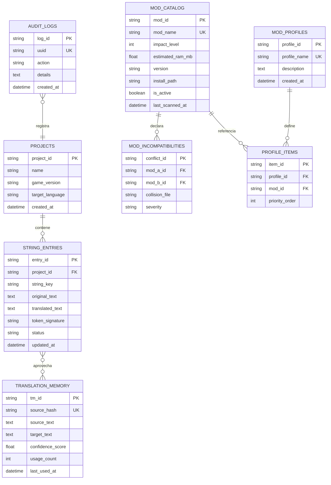

# Esquema y Modelado de Base de Datos - Solaris Nexus Studio

## 1. Motor de Persistencia Local
Solaris Nexus Studio implementa una arquitectura de base de datos local relacional con **SQLite 3** (`storage/database.sqlite`) como motor predeterminado de cero configuración, compatible además con **MySQL 8.0+** sobre el entorno WAMP.

El sistema de migraciones automáticas e idempotentes está gobernado por [database-migrator.php](file:///c:/wamp64/www/Clepces/projects/solaris-nexus-studio/src/backend/services/database-migrator.php).

---

## 2. Diagrama Entidad-Relación (ERD)

---

## 3. Diccionario Exhaustivo de Tablas

### 3.1 Tabla `projects` (Proyectos de Localización)
| Columna | Tipo | Restricción | Descripción |
| :--- | :--- | :--- | :--- |
| `project_id` | VARCHAR(36) | PRIMARY KEY | Identificador único del proyecto (UUID v4). |
| `name` | VARCHAR(120) | NOT NULL | Nombre descriptivo (ej. *"Traducción Oficial Rebellion v1.974"*). |
| `game_version` | VARCHAR(30) | NOT NULL | Versión del juego detectada (ej. `1.85`, `1.974`). |
| `target_language`| VARCHAR(10) | NOT NULL | Código ISO objetivo (predeterminado: `es`). |
| `created_at` | DATETIME | NOT NULL | Marca de tiempo UTC de creación. |

### 3.2 Tabla `string_entries` (Cadenas Léxicas .STR)
| Columna | Tipo | Restricción | Descripción |
| :--- | :--- | :--- | :--- |
| `entry_id` | VARCHAR(36) | PRIMARY KEY | Identificador único (UUID v4). |
| `project_id` | VARCHAR(36) | FOREIGN KEY | Vinculación a tabla `projects`. |
| `string_key` | VARCHAR(150) | NOT NULL, INDEX | Clave canónica del juego (ej. `IDSPlayerAINameTech0`). |
| `original_text` | TEXT | NOT NULL | Texto original en inglés. |
| `translated_text`| TEXT | NULL | Texto traducido al idioma objetivo. |
| `token_signature`| VARCHAR(255)| NULL | Hash de variables protegidas `{0}`, `{1}` para validación Token Guard. |
| `status` | VARCHAR(20) | DEFAULT 'pending'| Estado: `pending`, `translated`, `reviewed`, `error`. |
| `updated_at` | DATETIME | NOT NULL | Última modificación. |

### 3.3 Tabla `translation_memory` (Memoria de Traducción - TM)
Almacena un banco reutilizable de frases y términos del universo de Sins of a Solar Empire:
| Columna | Tipo | Restricción | Descripción |
| :--- | :--- | :--- | :--- |
| `tm_id` | VARCHAR(36) | PRIMARY KEY | Identificador UUID v4. |
| `source_hash` | VARCHAR(64) | UNIQUE, INDEX | Hash SHA-256 del texto en inglés en minúsculas y normalizado. |
| `source_text` | TEXT | NOT NULL | Frase en inglés original. |
| `target_text` | TEXT | NOT NULL | Correspondencia recomendada en español. |
| `confidence_score`| FLOAT | DEFAULT 1.0 | Puntuación de confianza (0.0 a 1.0). |
| `usage_count` | INT | DEFAULT 1 | Cantidad de veces reutilizado en traducciones. |
| `last_used_at`| DATETIME | NOT NULL | Último acceso para poda LRU si se requiere. |

### 3.4 Tabla `mod_catalog` (Registro de Mods y VFS)
| Columna | Tipo | Restricción | Descripción |
| :--- | :--- | :--- | :--- |
| `mod_id` | VARCHAR(36) | PRIMARY KEY | Identificador UUID v4. |
| `mod_name` | VARCHAR(150) | UNIQUE, INDEX | Nombre exacto de carpeta del mod. |
| `impact_level` | INT | NOT NULL (1, 2, 3) | Nivel: 1 (Asset/Texto), 2 (Expansión), 3 (Conversión Total). |
| `estimated_ram_mb`| FLOAT | NOT NULL | Memoria estimada calculada por el RAM Profiler. |
| `version` | VARCHAR(50) | NULL | Versión reportada por el modder. |
| `install_path`| VARCHAR(255)| NOT NULL | Ruta física completa en disco. |
| `is_active` | BOOLEAN | DEFAULT 0 | 1 si está declarado en `EnabledMods.txt`. |
| `last_scanned_at`| DATETIME | NOT NULL | Fecha del último análisis VFS. |

### 3.5 Tabla `audit_logs` (Protocolo de Cero Stack Traces - UUID Safety)
| Columna | Tipo | Restricción | Descripción |
| :--- | :--- | :--- | :--- |
| `log_id` | VARCHAR(36) | PRIMARY KEY | Identificador interno. |
| `uuid` | VARCHAR(36) | UNIQUE, INDEX | UUID público retornado al cliente en caso de error. |
| `action` | VARCHAR(80) | NOT NULL | Operación realizada (`STR_SAVE`, `MOD_TOGGLE`, `CONVERT_BIN`). |
| `details` | TEXT | NOT NULL | Detalle del evento o stack trace interno de depuración. |
| `created_at` | DATETIME | NOT NULL | Marca de tiempo UTC. |
