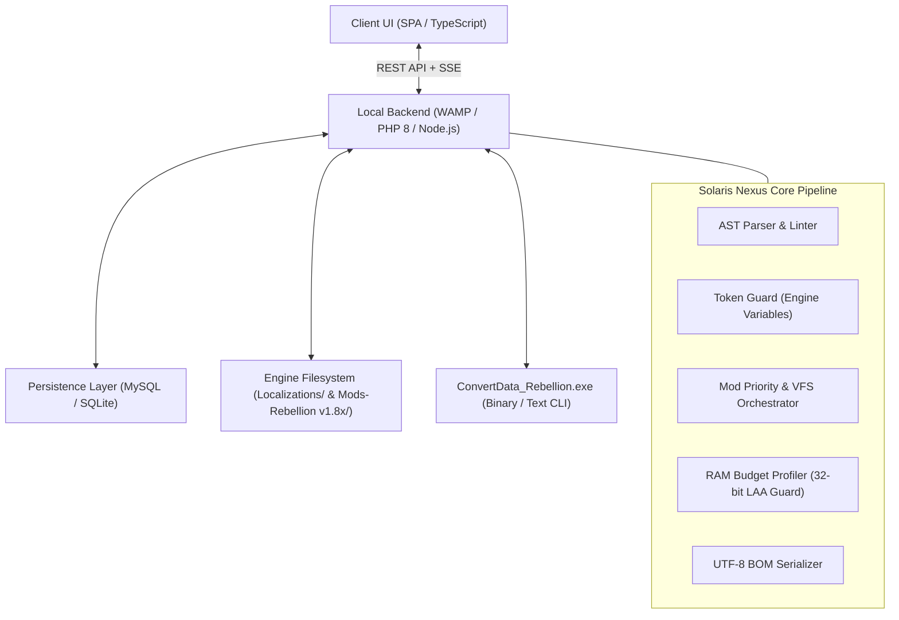

# System Architecture Specification - Solaris Nexus (v1.0.0)

## 1. High-Level System Architecture

Solaris Nexus is a unified web-based local management platform hosted in WAMP (`http://localhost/sins-of-sola-empire/`). It bridges the legacy 32-bit *Ironclad Games* C++ engine with modern web engineering, offering zero-risk string localization, mod prioritization, and native package deployment.

---

## 2. Technical Pillars

### 2.1. Pillar 1: Orchestration & Virtual File System (VFS)
Controls the descending resolution of game assets defined in `EnabledMods.txt`. Enables non-destructive mod localization by injecting isolated translation minimods at **Priority 999**, superseding original mod assets without altering their internal files.

### 2.2. Pillar 2: Security, Governance & Memory Budgeting
- **Zero Stack Traces (UUID Safety):** No disk paths or internal stack traces leak into client responses. All errors generate a traceable `error_uuid`.
- **Legacy 32-Bit Memory Safeguard:** The engine is constrained by a ~3.2 GB virtual address ceiling. Solaris Nexus calculates cumulative memory consumption across active mods to prevent out-of-memory *MiniDump* crashes.
- **Fail-Fast Environment Validation:** Verifies file existence and permissions before executing disk operations.

### 2.3. Pillar 3: Modularity & Phased Lifecycle
Organized around a progressive feature set using visual status badges:
- **Active Core:** Translation Studio (`.str`), Mod Orchestrator (`EnabledMods.txt`), and Native Language Packager.
- **In Development (Static Models):** 32-Bit RAM Budget Profiler and Entity Attribute Modifier.
- **Planned:** Interactive Galaxy Forge Companion.

### 2.4. Pillar 4: Asynchronous Transport & Data Persistence
Combines local REST endpoints with an asynchronous Pub/Sub Event Bus for real-time diagnostic alerts, backed by a relational schema for Translation Memory (TM) reuse.

---

## 3. Architectural Documentation Directory

| Document | Purpose & Scope |
| :--- | :--- |
| [api-spec.md](file:///C:/wamp64/www/sins-of-sola-empire/docs/en/api-spec.md) | REST API endpoints, JSON payload schemas, and UUID error tracking. |
| [events-spec.md](file:///C:/wamp64/www/sins-of-sola-empire/docs/en/events-spec.md) | Asynchronous Pub/Sub Event Bus contracts and event catalog. |
| [database-schema.md](file:///C:/wamp64/www/sins-of-sola-empire/docs/en/database-schema.md) | Relational ERD and DDL SQL schemas for projects, strings, and mods. |
| [project-structure.md](file:///C:/wamp64/www/sins-of-sola-empire/docs/en/project-structure.md) | Source code folder hierarchy, clean architecture, and kebab-case routing. |
| [ui-components.md](file:///C:/wamp64/www/sins-of-sola-empire/docs/en/ui-components.md) | UI/UX component modeling, virtualized DataGrid, and wireframe layouts. |
| [mod-system-spec.md](file:///C:/wamp64/www/sins-of-sola-empire/docs/en/mod-system-spec.md) | Sins VFS architecture, `EnabledMods.txt` syntax, and priority calculation. |
| [engineering-guidelines.md](file:///C:/wamp64/www/sins-of-sola-empire/docs/en/engineering-guidelines.md) | 32-bit RAM limits, ConvertData CLI, text clipping heuristics, and gotchas. |
| [user-guide.md](file:///C:/wamp64/www/sins-of-sola-empire/docs/en/user-guide.md) | Practical manual for activating Spanish and configuring mods. |

