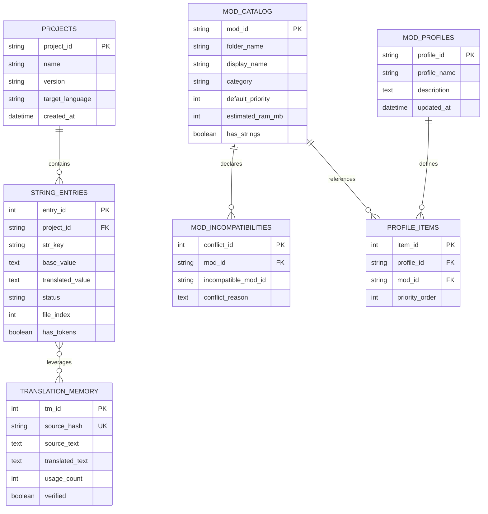

# Database Schema & Relational Modeling - Solaris Nexus (v1.0.0)

## 1. Storage Architecture
Solaris Nexus persists operational state via a lightweight local relational database (**MySQL 8.0+** in standard WAMP or zero-config **SQLite 3**). It stores:
1. **Localization Projects & String Dictionaries.**
2. **Translation Memory (TM):** Reusable English-to-Spanish matches for fast delta-mod localization.
3. **Mod Registry & Incompatibility Graph:** Tracks installed mods, memory weight, and conflict pairs.
4. **Mod Profiles:** One-click configurations of `EnabledMods.txt`.
5. **Security & Audit Logs (UUID Safety).**

---

## 2. Entity-Relationship Diagram (ERD)



---

## 3. Data Definition Language (DDL)

```sql
-- 1. Projects Table
CREATE TABLE tbl_projects (
    project_id VARCHAR(64) PRIMARY KEY,
    name VARCHAR(255) NOT NULL,
    version VARCHAR(32) NOT NULL,
    base_file_path VARCHAR(512) NOT NULL,
    target_file_path VARCHAR(512) NOT NULL,
    total_strings INT UNSIGNED NOT NULL DEFAULT 0,
    created_at TIMESTAMP DEFAULT CURRENT_TIMESTAMP,
    updated_at TIMESTAMP DEFAULT CURRENT_TIMESTAMP ON UPDATE CURRENT_TIMESTAMP
) ENGINE=InnoDB DEFAULT CHARSET=utf8mb4 COLLATE=utf8mb4_unicode_ci;

-- 2. String Entries Table
CREATE TABLE tbl_string_entries (
    entry_id INT UNSIGNED AUTO_INCREMENT PRIMARY KEY,
    project_id VARCHAR(64) NOT NULL,
    str_key VARCHAR(191) NOT NULL,
    base_value MEDIUMTEXT NOT NULL,
    translated_value MEDIUMTEXT NULL,
    status ENUM('TRANSLATED', 'UNTRANSLATED', 'PENDING', 'PROTECTED', 'ERROR') DEFAULT 'PENDING',
    file_index INT UNSIGNED NOT NULL,
    has_tokens BOOLEAN DEFAULT FALSE,
    token_metadata JSON NULL,
    FOREIGN KEY (project_id) REFERENCES tbl_projects(project_id) ON DELETE CASCADE,
    INDEX idx_project_key (project_id, str_key),
    INDEX idx_status (status)
) ENGINE=InnoDB DEFAULT CHARSET=utf8mb4 COLLATE=utf8mb4_unicode_ci;

-- 3. Translation Memory (TM) Table
CREATE TABLE tbl_translation_memory (
    tm_id INT UNSIGNED AUTO_INCREMENT PRIMARY KEY,
    source_hash CHAR(64) NOT NULL UNIQUE, -- SHA-256 of cleaned English text
    source_text MEDIUMTEXT NOT NULL,
    translated_text MEDIUMTEXT NOT NULL,
    context_tag VARCHAR(64) DEFAULT 'GENERAL',
    usage_count INT UNSIGNED DEFAULT 1,
    verified BOOLEAN DEFAULT FALSE,
    created_at TIMESTAMP DEFAULT CURRENT_TIMESTAMP,
    INDEX idx_source_hash (source_hash)
) ENGINE=InnoDB DEFAULT CHARSET=utf8mb4 COLLATE=utf8mb4_unicode_ci;

-- 4. Mod Catalog Table
CREATE TABLE tbl_mod_catalog (
    mod_id VARCHAR(64) PRIMARY KEY,
    folder_name VARCHAR(255) NOT NULL,
    display_name VARCHAR(255) NOT NULL,
    category ENUM('TOTAL_CONVERSION', 'OVERHAUL', 'GAMEPLAY_MINIMOD', 'GRAPHICS', 'TRANSLATION_PATCH') NOT NULL,
    default_priority INT NOT NULL DEFAULT 10,
    estimated_ram_mb INT UNSIGNED NOT NULL DEFAULT 150,
    has_strings BOOLEAN DEFAULT FALSE,
    detected_at TIMESTAMP DEFAULT CURRENT_TIMESTAMP
) ENGINE=InnoDB DEFAULT CHARSET=utf8mb4 COLLATE=utf8mb4_unicode_ci;

-- 5. Mod Incompatibilities Table
CREATE TABLE tbl_mod_incompatibilities (
    conflict_id INT UNSIGNED AUTO_INCREMENT PRIMARY KEY,
    mod_id VARCHAR(64) NOT NULL,
    incompatible_mod_id VARCHAR(64) NOT NULL,
    conflict_reason TEXT NOT NULL,
    FOREIGN KEY (mod_id) REFERENCES tbl_mod_catalog(mod_id) ON DELETE CASCADE,
    UNIQUE KEY uk_conflict_pair (mod_id, incompatible_mod_id)
) ENGINE=InnoDB DEFAULT CHARSET=utf8mb4 COLLATE=utf8mb4_unicode_ci;

-- 6. Mod Profiles & Items Tables
CREATE TABLE tbl_mod_profiles (
    profile_id VARCHAR(64) PRIMARY KEY,
    profile_name VARCHAR(128) NOT NULL,
    description TEXT NULL,
    created_at TIMESTAMP DEFAULT CURRENT_TIMESTAMP
) ENGINE=InnoDB DEFAULT CHARSET=utf8mb4 COLLATE=utf8mb4_unicode_ci;

CREATE TABLE tbl_profile_items (
    item_id INT UNSIGNED AUTO_INCREMENT PRIMARY KEY,
    profile_id VARCHAR(64) NOT NULL,
    mod_id VARCHAR(64) NOT NULL,
    priority_order INT NOT NULL,
    FOREIGN KEY (profile_id) REFERENCES tbl_mod_profiles(profile_id) ON DELETE CASCADE,
    FOREIGN KEY (mod_id) REFERENCES tbl_mod_catalog(mod_id) ON DELETE CASCADE
) ENGINE=InnoDB DEFAULT CHARSET=utf8mb4 COLLATE=utf8mb4_unicode_ci;

-- 7. Audit & UUID Error Log Table
CREATE TABLE tbl_audit_logs (
    log_id INT UNSIGNED AUTO_INCREMENT PRIMARY KEY,
    error_uuid CHAR(36) NOT NULL UNIQUE,
    event_type VARCHAR(64) NOT NULL,
    message TEXT NOT NULL,
    technical_stack MEDIUMTEXT NULL,
    created_at TIMESTAMP DEFAULT CURRENT_TIMESTAMP,
    INDEX idx_uuid (error_uuid)
) ENGINE=InnoDB DEFAULT CHARSET=utf8mb4 COLLATE=utf8mb4_unicode_ci;
```
