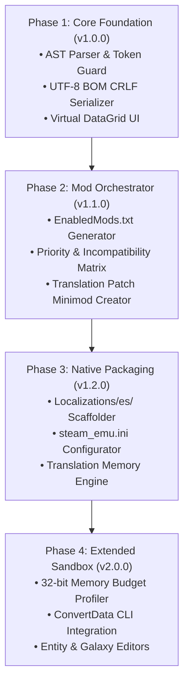

# Engineering Guidelines, Engine Limits & Pitfall Prevention - Solaris Nexus (v1.0.0)

## 1. Ironclad Engine Technical Constraints & Gotchas

Developing software that interfaces with *Sins of a Solar Empire: Rebellion* requires navigating the strict, unyielding behavior of its legacy 32-bit C++ engine.

### 1.1. The 32-Bit Large Address Aware (LAA) Memory Wall
- **The Physical Limit:** As a 32-bit DirectX 9 application, the engine has a hard virtual address limit of **~3.2 GB to 3.8 GB of RAM**, regardless of whether the user possesses 32 GB, 64 GB, or 128 GB of physical RAM.
- **The Crash Mechanism:** When virtual address allocation crosses ~3,250 MB, the next allocation failure (`malloc` / `new`) triggers an unhandled C++ exception, instantly dumping a `.dmp` file (*MiniDump Crash*).
- **Memory Budgeting Rules for Solaris Nexus:**
  ```text
  Base Game + Engine Overhead:       ~1,400 MB
  Overhaul Mod (e.g., E4X):          +  450 MB (Total: ~1,850 MB - SAFE)
  Total Conversion (e.g., SWINT):    +1,250 MB (Total: ~2,650 MB - MODERATE)
  Minimods (HD Textures / 2x Fleet): +  700 MB (Total: ~3,350 MB - CRITICAL DANGER)
  ```
- **Development Rule:** Solaris Nexus must calculate and display an estimated cumulative memory weight in `EnabledMods.txt`. If the threshold exceeds 3,100 MB, the UI must display a **High Memory Alert** informing the user that large galaxy battles will likely collapse.

---

### 1.2. The Strict Encoding Triad: UTF-8 + BOM + CRLF
The engine's string parser fails silently or produces character corruption (mojibake) if any of the following three rules is broken:
1. **UTF-8 Byte Order Mark (BOM):** The first three bytes of any `.str` file must strictly be `0xEF 0xBB 0xBF`.
2. **Carriage Return + Line Feed (CRLF):** Every line must terminate in `\r\n` (`0x0D 0x0A`). Standard Linux/Unix `\n` line endings will corrupt the line counter.
3. **Canonical Header:** Line 1 must be `TXT\r\n` and Line 2 must be `NumStrings <N>\r\n`.

```typescript
// Standard Solaris Nexus Serializer Buffer Enforcement
export function createSafeStringBuffer(content: string): Uint8Array {
  const BOM = new Uint8Array([0xEF, 0xBB, 0xBF]);
  const encoder = new TextEncoder();
  const normalizedText = content.replace(/\r?\n/g, "\r\n");
  const encodedText = encoder.encode(normalizedText);

  const finalBuffer = new Uint8Array(BOM.length + encodedText.length);
  finalBuffer.set(BOM, 0);
  finalBuffer.set(encodedText, BOM.length);
  return finalBuffer;
}
```

---

### 1.3. UI String Length & Expansion Heuristics (Clipping Prevention)
- **The Expansion Factor:** Spanish text is naturally **20% to 30% longer** than English text.
- **Fixed InfoCard Bounds:** The engine renders text within fixed-dimension texture boxes. If a weapon description or planet bonus exceeds the bounding box, text will overflow or truncate abruptly.
- **The Character Ratio Heuristic:**
  ```typescript
  export function checkTextExpansionRisk(enText: string, esText: string): "SAFE" | "WARNING" | "OVERFLOW_RISK" {
    if (enText.length < 15) return "SAFE";
    const ratio = esText.length / enText.length;
    if (ratio > 1.6) return "OVERFLOW_RISK";
    if (ratio > 1.35) return "WARNING";
    return "SAFE";
  }
  ```

---

### 1.4. Multiplayer Checksum Immunity vs Entity Sync
- **Localization Files (`.str`):** String dictionaries are strictly client-side presentation assets. **Modifying `English.str` has zero impact on multiplayer network checksums.** A player with the game translated to Spanish can play seamlessly with a host running pure English without desynchronization.
- **Entity & Gameplay Files (`.entity`, `.galaxy`, `.mesh`):** Modifying any entity (e.g. ship shields, starting resources, research costs) changes the internal checksum. If a player connects to a multiplayer match with modified entities, the engine immediately aborts with a network desync.
- **Governance:** In Solaris Nexus, any future Entity/Balance Modifiers must carry an explicit **Single-Player / Modding Only** badge to prevent accidental multiplayer kicks.

---

### 1.5. String Table Memory Ceiling & Per-Mod Budgeting
- **Internal Engine Overhead:** The engine does not store strings as a single contiguous text stream. Each `StringInfo` entry allocates a C++ runtime structure with pointer table entries, ID hash keys, and metadata (~64 bytes overhead per entry) and converts characters internally to UTF-16 (2 bytes per character).
- **Actual Heap Footprint:**
  - Base Game (~7,828 strings): ~2.5 MB string heap.
  - Large Total Conversion (e.g., *Sins of the Prophets* with ~14,000 strings): ~4.8 MB.
  - **Unmanaged Mega-File** (45,000+ strings aggregating 100 installed but inactive mods): ~20 MB to 30 MB solely for string tables.
- **32-Bit Allocation Risk:** While 30 MB seems negligible on modern 64-bit systems, in DirectX 9's 3.2 GB virtual address space, large string heaps fragment contiguous memory blocks, accelerating `OUT_OF_MEMORY` crashes when loading heavy capital ship texture sets.
- **Synthesis Directive:** Solaris Nexus **never compiles inactive mod strings**. It only synthesizes the string subset belonging to mods actively listed in `EnabledMods.txt`.

---

## 2. Binary vs Text Data: `ConvertData_Rebellion.exe` Integration

*Sins of a Solar Empire* stores entities in two states: human-readable text (`TXT`) and compiled binary (`BIN`). The game ships with an official conversion tool located in the root installation directory:
```text
C:\Games\Sins of a Solar Empire Rebellion\ConvertData_Rebellion.exe
```

### CLI Command Specifications for Solaris Nexus:
```powershell
# Decompile Binary Entity/Galaxy to Human-Readable Text:
ConvertData_Rebellion.exe entity input.entity output.entity txt

# Compile Text Entity/Galaxy to Binary (Optimized for Engine Speed):
ConvertData_Rebellion.exe entity input.entity output.entity bin
```

When building future modules (Entity Modifier or Galaxy Forge), Solaris Nexus will leverage `ConvertData_Rebellion.exe` behind the scenes to convert compiled binary mod files into editable JSON/Text structures and recompile them cleanly.

---

## 3. Engineering Recommendations for Development Phases



### Key Advice for Implementation:
1. **Never mutate master files in place:** Always maintain pre-write safety backups in `storage/backups/`.
2. **Strict Regex Boundaries:** Do not use simple string replacement for tokens like `%s` or `%d`; use regex matchers to ensure numbers and format identifiers match exact quantities.
3. **Virtual DOM is mandatory:** Do not attempt to render all 7,828 `<tr>` elements into a standard HTML table simultaneously; the browser will freeze. Use virtual scrolling (`datatable-virtual.css`).
