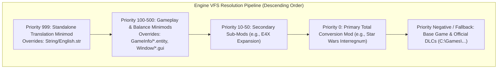
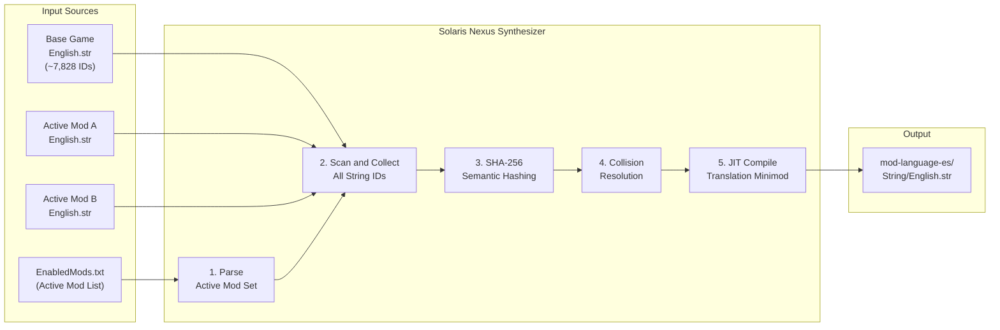

# Mod Architecture & VFS Specification - Solaris Nexus (v1.0.0)

## 1. The Virtual File System (VFS) of Sins of a Solar Empire

The *Ironclad Games* engine operates using an layered **Virtual File System (VFS)**. At runtime, the engine resolves asset requests by querying layers in strictly descending priority order:



When an entity, texture, sound, or string is requested (such as `String\English.str`), the VFS serves the first occurrence found in the active mod list. If no active mod contains the requested file, the engine falls back to the native game installation directory.

---

## 2. Standard Grammar of `EnabledMods.txt`

The active mod list and execution order are persisted in:
```text
C:\Users\<User>\Documents\My Games\Ironclad Games\Sins of a Solar Empire Rebellion\Mods-Rebellion v1.8x\EnabledMods.txt
```

### Canonical File Grammar:
```text
TXT2
SinsArchiveVersion 197
Version 0
enabledModNameCount <INTEGER_COUNT>
enabledModName "<EXACT_FOLDER_NAME_1>"
enabledModName "<EXACT_FOLDER_NAME_2>"
...
```

### Critical Rules:
1. **Precedence Inversion:** The first item (`enabledModName` on line 5) holds the **highest priority** in the VFS hierarchy.
2. **Strict Count Verification:** `enabledModNameCount` must match the exact number of subsequent `enabledModName` lines. Any mismatch causes the game to reject the file or restore default settings.
3. **Exact Case Sensitivity:** Mod folder names must match the filesystem directory names within `Mods-Rebellion v1.8x/` identically.

---

## 3. Mod Classification & Text Scope

| Mod Category | Examples | Total Strings | Linguistic Scope |
| :--- | :--- | :---: | :--- |
| **Total Conversions** | *Star Wars: Interregnum*, *Star Trek: Armada III*, *Sins of the Prophets* | 9,000 - 14,000 | Replaces all factions, ships, weapons, and research trees. Introduces thousands of custom IDs. |
| **Overhauls & Expansions** | *Enhanced 4X Mod (E4X)*, *Distant Stars* | 8,000 - 9,500 | Retains base factions (TEC, Advent, Vasari), adding deep economic, diplomatic, and governmental layers. |
| **Gameplay Minimods** | *Doubled Fleet Supply*, *Faster Combat*, *Infinite Research* | 5 - 50 | Tweaks balance constants, entity definitions, and small UI multipliers. Minimal text footprint. |

---

## 4. Standalone Translation Minimod Architecture (Priority 999)

Directly modifying files inside a third-party mod's directory introduces major operational liabilities:
- Game or mod updates wipe all custom translations.
- Checksums can be corrupted in multiplayer sessions.

### The Solaris Nexus Solution: Zero-Touch Translation Minimods
Solaris Nexus compiles an isolated, lightweight mod package:
```text
C:\Users\<User>\Documents\My Games\Ironclad Games\...\Mods-Rebellion v1.8x\
  └── [ES] Star Wars Interregnum Traduccion/
      └── String/
          └── English.str   <-- (Only translated strings with UTF-8 BOM)
```

In `EnabledMods.txt`, this patch is placed at the top (`Priority 999`). The game loads all 3D meshes, textures, sounds, and particle effects from the original English mod, but retrieves all textual strings from the translation patch.

---

## 5. Mod Conflict Resolution Algorithm

Derived from the battle-tested `E4XInterregnumModManager.js` logic, the orchestrator evaluates cross-mod compatibility before writing to disk:

```typescript
export interface ModItem {
  id: string;
  name: string;
  priority: number;
  incompatibleMods: string[];
  category: "TOTAL_CONVERSION" | "OVERHAUL" | "MINIMOD" | "TRANSLATION";
}

export function compileEnabledMods(selectedMods: ModItem[]): string {
  // 1. Conflict Detection
  const activeIds = new Set(selectedMods.map(m => m.id));
  for (const mod of selectedMods) {
    for (const conflict of mod.incompatibleMods) {
      if (activeIds.has(conflict)) {
        throw new Error(`Incompatibility: ${mod.name} collides with ${conflict}`);
      }
    }
  }

  // 2. Descending Priority Sort (Higher priority placed first)
  const sorted = [...selectedMods].sort((a, b) => b.priority - a.priority);

  // 3. Canonical TXT2 SinsArchiveVersion 197 Serialization
  let buffer = "TXT2\r\nSinsArchiveVersion 197\r\nVersion 0\r\n";
  buffer += `enabledModNameCount ${sorted.length}\r\n`;
  for (const mod of sorted) {
    buffer += `enabledModName "${mod.name}"\r\n`;
  }

  return buffer;
}
```

---

## 6. Active-Set Language Synthesizer (Dynamic Mod Translation)

> **Badge:** `🟡 IN DEVELOPMENT`

### 6.1 Problem Statement

A user may have 50+ mods installed, but only 3–6 active simultaneously. Loading the string tables of *all* installed mods into a single mega-file is **catastrophically dangerous** on a 32-bit engine:

| Risk | Description |
| :--- | :--- |
| **Memory Exhaustion** | A mega-file with 40,000+ entries can consume 15–30 MB of string heap. With the LAA ceiling at ~3.2 GB, this steals budget from textures and meshes. |
| **Lore Cannibalism** | If *Star Wars: Interregnum* and *Sins of the Prophets* both define `IDS_SHIP_CAPITAL_01`, the mega-file silently overwrites one with the other. The player sees "Star Destroyer" in a Halo mod — or vice versa. |
| **Phantom Strings** | IDs from inactive mods may still be resolved by the VFS, causing UI elements to display text from mods that are not loaded, resulting in nonsensical descriptions. |

### 6.2 Architecture: Session-Scoped Synthesis

Instead of a global file, Solaris Nexus generates a **per-session translation minimod** that contains *only* the union of strings from currently active mods.



### 6.3 SHA-256 Semantic Collision Detection

When two mods define the same `StringInfo.ID`, the synthesizer must determine whether they represent the **same concept** or **different lore**:

```typescript
import { createHash } from "crypto";

export interface StringEntry {
  id: string;
  value: string;
  sourceModId: string;
}

export type CollisionVerdict = "AUTO_TRANSLATE" | "MANUAL_REVIEW";

export interface CollisionReport {
  id: string;
  entries: StringEntry[];
  verdict: CollisionVerdict;
  fingerprint: string;
}

/**
 * Computes a normalized SHA-256 fingerprint of the English base text.
 * Two entries with identical fingerprints => same concept => auto-translate.
 * Different fingerprints => different lore => manual review required.
 */
export function computeSemanticFingerprint(value: string): string {
  const normalized = value
    .toLowerCase()
    .replace(/\s+/g, " ")
    .trim();
  return createHash("sha256").update(normalized, "utf8").digest("hex");
}

export function detectCollisions(
  allEntries: StringEntry[]
): CollisionReport[] {
  const grouped = new Map<string, StringEntry[]>();

  for (const entry of allEntries) {
    const existing = grouped.get(entry.id) ?? [];
    existing.push(entry);
    grouped.set(entry.id, existing);
  }

  const reports: CollisionReport[] = [];

  for (const [id, entries] of grouped) {
    if (entries.length <= 1) continue;

    const fingerprints = new Set(
      entries.map((e) => computeSemanticFingerprint(e.value))
    );

    reports.push({
      id,
      entries,
      verdict: fingerprints.size === 1 ? "AUTO_TRANSLATE" : "MANUAL_REVIEW",
      fingerprint: [...fingerprints].join(" | "),
    });
  }

  return reports;
}
```

#### Decision Matrix

| Scenario | Fingerprints | Action |
| :--- | :---: | :--- |
| Same ID, same English text (e.g., both say "Attack") | 1 unique | `AUTO_TRANSLATE` — apply cached Spanish translation |
| Same ID, different English text (e.g., "TIE Fighter" vs "Seraph Fighter") | 2+ unique | `MANUAL_REVIEW` — flag for user in the UI with a diff viewer |
| Unique ID across all mods | N/A | `AUTO_TRANSLATE` — no collision, translate normally |

### 6.4 JIT Minimod Compilation

After collision resolution, the synthesizer assembles the final output:

```text
Mods-Rebellion v1.8x/
  mod-language-es/
      String/
          English.str    <- Union of all resolved translations
      meta.json          <- Solaris Nexus build manifest
```

**`meta.json` Schema:**
```json
{
  "generator": "solaris-nexus",
  "version": "1.0.0",
  "targetLanguage": "es",
  "buildTimestamp": "2026-10-18T23:45:00Z",
  "sourceMods": [
    { "id": "star-wars-interregnum", "stringsContributed": 4200 },
    { "id": "e4x-mod", "stringsContributed": 1350 }
  ],
  "totalStrings": 13378,
  "collisionsAutoResolved": 42,
  "collisionsManualPending": 3
}
```

The synthesizer automatically registers `mod-language-es` at position 1 in `EnabledMods.txt` (Priority 999), ensuring it overrides all other string sources.

### 6.5 Memory Budget Estimation

Before compiling, the synthesizer estimates whether the resulting string table fits within the 32-bit memory budget:

```typescript
export interface MemoryEstimate {
  totalStrings: number;
  estimatedBytes: number;
  percentOfBudget: number;
  safe: boolean;
}

const LAA_CEILING_BYTES = 3_355_443_200; // ~3.12 GiB practical limit
const STRING_OVERHEAD_BYTES = 64; // Per-entry engine overhead
const SAFE_STRING_BUDGET_PERCENT = 2.0; // Strings should not exceed 2%

export function estimateStringMemory(
  entries: Array<{ value: string }>
): MemoryEstimate {
  const totalBytes = entries.reduce((sum, e) => {
    // UTF-16 in engine memory: 2 bytes per char + overhead
    return sum + e.value.length * 2 + STRING_OVERHEAD_BYTES;
  }, 0);

  const percent = (totalBytes / LAA_CEILING_BYTES) * 100;

  return {
    totalStrings: entries.length,
    estimatedBytes: totalBytes,
    percentOfBudget: Math.round(percent * 100) / 100,
    safe: percent <= SAFE_STRING_BUDGET_PERCENT,
  };
}
```

| String Count | Estimated Memory | % of 3.12 GiB | Verdict |
| ---: | ---: | ---: | :--- |
| 8,000 (base game) | ~2.5 MB | 0.07% | Safe |
| 14,000 (base + TC mod) | ~4.8 MB | 0.14% | Safe |
| 30,000 (base + 3 TC mods) | ~11 MB | 0.33% | Marginal |
| 50,000+ (mega-file) | ~20 MB+ | 0.60%+ | Risky — texture budget stolen |

### 6.6 Unsynthesizable Edge Cases

Some scenarios cannot be resolved automatically:

1. **Binary-Embedded Strings:** Some mods hardcode strings directly in `.entity` or `.mesh` files. These are not accessible via `.str` files and cannot be translated without binary patching.
2. **Dynamic String Concatenation:** If a mod constructs strings at runtime (e.g., `"Ship: " + shipName`), the concatenation fragments may not appear as complete translatable units.
3. **Font Coverage Gaps:** Translated text may use characters (ñ, á, ü) not present in the mod's custom font file. Solaris Nexus must validate `Font/*.font` glyph coverage before deployment.
4. **Mod-Specific Formatting Codes:** Some mods use custom formatting tokens (`%MOD_VAR%`, `[color:...]`) that must be preserved verbatim during translation.

---

## 7. Architecture Comparison: Rebellion (32-bit) vs. Sins of a Solar Empire II (64-bit)

> **Badge:** `PLANNED`

The release of **Sins of a Solar Empire II** represents a generational leap in both engine technology and modding infrastructure:

### 7.1 Technical Comparison Matrix

| Technical Dimension | Sins of a Solar Empire: Rebellion | Sins of a Solar Empire II |
| :--- | :--- | :--- |
| **Game Engine** | Legacy Iron Engine (32-bit / DirectX 9) | **Iron Engine 3** (Native 64-bit / DirectX 12) |
| **RAM Addressing Ceiling** | ~3.2 GB to 3.8 GB (LAA Wall - MiniDump Crash) | **Unlimited** (Full access to system physical RAM) |
| **Source String Format** | Rigid `.str` file with `TXT/NumStrings` header | Structured CSV tables (`.localized_text_csv`) |
| **Runtime String Format** | Engine-internal UTF-16 hardcoded to `English.str` | Compiled **JSON files** (`.localized_text`) |
| **Official Localization Tool** | None (manual flat file editing) | `LocalizedTextBuilder` and `Peon` build pipeline (Official SDK) |
| **Mod Distribution** | Manual via [ModDB](https://www.moddb.com/games/sins-of-a-solar-empire-rebellion/mods) + `EnabledMods.txt` | **Native mod.io integration** in main game menu |
| **Multiplayer Sync** | Players must manually match mod installation folders | Automatic download & synchronization on lobby join |
| **Local Mod Storage** | `Documents\My Games\Ironclad Games\...\Mods-Rebellion v1.8x\` | `%LOCALAPPDATA%\sins2\mods\` |

### 7.2 Localization Pipeline in Sins II vs. Solaris Nexus

In Sins II, the official localization workflow consists of:
1. **Authoring:** Translators edit clean CSV tables (`es.localized_text_csv`) using `Key,Source,Target` columns.
2. **Compilation:** The `LocalizedTextBuilder` CLI or the `run-peon.py` tool converts CSV sheets into engine-ready JSON structures.
3. **Publishing:** Packages are pushed directly to the **mod.io** platform via its public REST API.

**Solaris Nexus Evolution Strategy:**
Solaris Nexus is engineered with modular decoupled layers:
- **v1.x (Rebellion):** Specializes in `.str` syntax, UTF-8 BOM, CRLF, and `EnabledMods.txt` VFS orchestration.
- **v2.x (Sins II Ready):** Introduces adapters to export Translation Memories to `.localized_text_csv` and integrate directly with the mod.io REST API via OAuth2 authentication.

