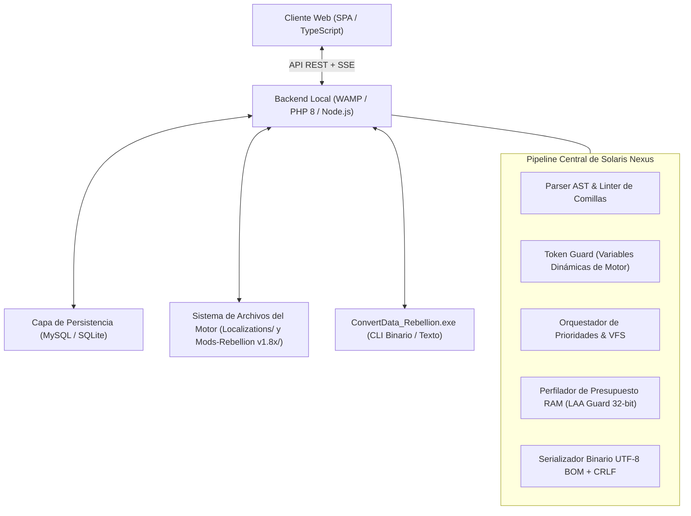

# Especificación de Arquitectura del Sistema - Solaris Nexus (v1.0.0)

## 1. Arquitectura de Alto Nivel

**Solaris Nexus** es una plataforma de ingeniería y suite web local alojada en WAMP (`http://localhost/sins-of-sola-empire/`). Conecta el motor heredado en C++ de 32 bits de *Ironclad Games* con estándares modernos de desarrollo web, permitiendo la localización universal de cadenas, la orquestación de prioridades de mods y el empaquetado nativo de idiomas sin riesgo de corrupción binaria.

---

## 2. Pilares Técnicos Fundamentales

### 2.1. Pilar 1: Orquestación y Sistema de Archivos Virtual (VFS)
Gobierna la resolución en cascada de los recursos declarados en `EnabledMods.txt`. Permite la traducción no destructiva de mods mediante la inyección de minimods de traducción independientes con **Prioridad 999**, superponiéndose a los archivos originales del mod sin alterar su estructura interna.

### 2.2. Pilar 2: Seguridad, Gobernanza y Control de Memoria
- **Protocolo de Cero Stack Traces (UUID Safety):** Ninguna ruta física de disco ni volcado de memoria se expone en las respuestas del cliente. Todos los errores generan un código `error_uuid` rastreable internamente en los registros de auditoría.
- **Protección contra el Límite de Memoria de 32 Bits:** El ejecutable del juego está limitado a un techo de ~3.2 GB de memoria virtual (incluso con Large Address Aware). Solaris Nexus calcula el consumo acumulado de los mods activos para advertir y prevenir cierres abruptos por agotamiento de memoria (*MiniDump Crash*).
- **Validación Fail-Fast:** Comprueba de forma estricta la existencia de archivos y permisos antes de autorizar escrituras en disco.

### 2.3. Pilar 3: Modularidad y Ciclo de Vida Evolutivo
Organizado mediante un catálogo de componentes visuales con **Badges de Estado**:
- **Núcleo Activo:** Estudio de Traducción (`.str`), Orquestador de Mods (`EnabledMods.txt`) y Empaquetador de Idioma Nativo.
- **En Desarrollo (Modelos Estáticos):** Monitor de Presupuesto de RAM de 32 bits y Editor de Atributos de Entidades.
- **Próximamente:** Visualizador interactivo de mapas galácticos (Galaxy Forge Companion).

### 2.4. Pilar 4: Transporte Asíncrono y Persistencia
Combina una API REST local con un **Bus de Eventos Pub/Sub** para alertas de diagnóstico en tiempo real, respaldado por una base de datos relacional para la reutilización de Memoria de Traducción (TM).

---

## 3. Directorio de Documentación Técnica en Español

| Documento | Alcance y Contenido |
| :--- | :--- |
| [api-spec.md](file:///C:/wamp64/www/sins-of-sola-empire/docs/es/api-spec.md) | Endpoints REST, esquemas de payload JSON y protocolo de seguridad UUID. |
| [events-spec.md](file:///C:/wamp64/www/sins-of-sola-empire/docs/es/events-spec.md) | Contratos del Bus de Eventos asíncrono y catálogo de eventos del sistema. |
| [database-schema.md](file:///C:/wamp64/www/sins-of-sola-empire/docs/es/database-schema.md) | Diagrama ERD y esquemas DDL SQL para proyectos, cadenas y perfiles de mods. |
| [project-structure.md](file:///C:/wamp64/www/sins-of-sola-empire/docs/es/project-structure.md) | Organización de código fuente, arquitectura limpia y nomenclatura kebab-case. |
| [ui-components.md](file:///C:/wamp64/www/sins-of-sola-empire/docs/es/ui-components.md) | Modelado de componentes UI/UX, tabla virtualizada y wireframes. |
| [mod-system-spec.md](file:///C:/wamp64/www/sins-of-sola-empire/docs/es/mod-system-spec.md) | Arquitectura VFS, sintaxis de `EnabledMods.txt` y cálculo de prioridades. |
| [engineering-guidelines.md](file:///C:/wamp64/www/sins-of-sola-empire/docs/es/engineering-guidelines.md) | Techo de 32 bits, integración con ConvertData, heurísticas y prevención de fallos. |
| [user-guide.md](file:///C:/wamp64/www/sins-of-sola-empire/docs/es/user-guide.md) | Manual operativo paso a paso para activación de idioma y gestión de mods. |
