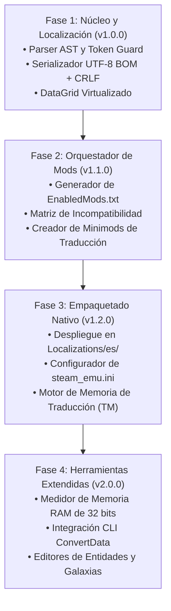

# Guía de Ingeniería, Límites del Motor de 32 Bits y Prevención de Fallos - Solaris Nexus (v1.0.0)

## 1. Restricciones Técnicas del Motor de Ironclad Games

Desarrollar software que interactúa con *Sins of a Solar Empire: Rebellion* exige respetar el comportamiento de su motor heredado en C++ de 32 bits.

### 1.1. El Límite Físico de Memoria RAM de 32 Bits (LAA)
- **El Techo Real:** Al ser una aplicación de 32 bits bajo DirectX 9, el motor tiene un espacio de direccionamiento virtual limitado a **~3.2 GB a 3.8 GB de memoria RAM**, independientemente de que el equipo disponga de 32 GB, 64 GB o 128 GB de memoria física.
- **Mecanismo del Fallo:** Cuando la asignación de memoria virtual supera los ~3.250 MB, la siguiente petición de asignación (`malloc` / `new`) genera una excepción no controlada en C++, cerrando el juego y generando un archivo `.dmp` (*MiniDump Crash*).
- **Presupuesto de Memoria en Solaris Nexus:**
  ```text
  Juego Base + Consumo del Motor:    ~1.400 MB
  Mod de Expansión (ej. E4X):        +  450 MB (Total: ~1.850 MB - SEGURO)
  Conversión Total (ej. SWINT):      +1.250 MB (Total: ~2.650 MB - MODERADO)
  Minimods (Texturas HD / Flotas x2):+  700 MB (Total: ~3.350 MB - PELIGRO EXTREMO)
  ```
- **Regla de Desarrollo:** Solaris Nexus calcula y muestra el consumo acumulado estimado de los mods activos en `EnabledMods.txt`. Si supera los 3.100 MB, la interfaz muestra una **Alerta de Memoria Alta** advirtiendo que las batallas galácticas masivas provocarán un cierre del juego.

---

### 1.2. La Tríada Estricta de Codificación: UTF-8 + BOM + CRLF
El analizador de cadenas del juego falla o genera caracteres corruptos (mojibake) si se infringe cualquiera de estas tres condiciones:
1. **Firma Byte Order Mark (BOM):** Los primeros tres bytes del archivo `.str` deben ser obligatoriamente `0xEF 0xBB 0xBF`.
2. **Retorno de Carro + Salto de Línea (CRLF):** Cada línea debe terminar en `\r\n` (`0x0D 0x0A`). Los saltos estilo Linux (`\n`) desincronizan el contador de líneas del motor.
3. **Cabecera Canónica:** La línea 1 debe ser `TXT\r\n` y la línea 2 `NumStrings <N>\r\n`.

```typescript
// Implementación del serializador seguro en Solaris Nexus
export function createSafeStringBuffer(content: string): Uint8Array {
  const BOM = new Uint8Array([0xEF, 0xBB, 0xBF]);
  const encoder = new TextEncoder();
  const normalizedText = content.replace(/\r?\n/g, "\r\n");
  const encodedText = encoder.encode(normalizedText);

  const finalBuffer = new Uint8Array(BOM.length + encodedText.length);
  finalBuffer.set(BOM, 0);
  finalBuffer.set(encodedText, BOM.length);
  return finalBuffer;
}
```

---

### 1.3. Heurística de Longitud de Texto y Prevención de Recorte Visual (*Clipping*)
- **Factor de Expansión:** El texto en español es un **20% a 30% más largo** que en inglés.
- **Límites Fijos de InfoCard:** El juego renderiza el texto en cajas de textura de dimensiones fijas. Si una descripción supera el cuadro delimitador, el texto se corta abruptamente.
- **Función Heurística de Detección:**
  ```typescript
  export function checkTextExpansionRisk(enText: string, esText: string): "SAFE" | "WARNING" | "OVERFLOW_RISK" {
    if (enText.length < 15) return "SAFE";
    const ratio = esText.length / enText.length;
    if (ratio > 1.6) return "OVERFLOW_RISK";
    if (ratio > 1.35) return "WARNING";
    return "SAFE";
  }
  ```

---

### 1.4. Inmunidad de Checksum Multijugador vs Modificación de Entidades
- **Archivos de Texto (`.str`):** Los diccionarios de cadenas son activos puramente visuales del cliente. **Modificar `English.str` no afecta el checksum de red.** Un jugador con el juego en español puede jugar en multijugador con un anfitrión en inglés sin desincronización.
- **Archivos de Entidades (`.entity`, `.galaxy`, `.mesh`):** Modificar cualquier entidad (escudos, recursos, costes) altera el checksum. Si un jugador entra a una partida multijugador con entidades modificadas, el juego lo desconecta de inmediato.
- **Gobernanza:** En Solaris Nexus, cualquier futuro editor de entidades debe mostrar de forma visible la etiqueta de **Uso Exclusivo en Un Jugador / Sandbox** para evitar desconexiones accidentales.

---

### 1.5. Techo de Memoria de la Tabla de Cadenas y Presupuesto por Mod
- **Sobrecarga Interna por Entrada:** El motor no almacena las cadenas como texto plano continuo; cada entrada en `StringInfo` reserva una estructura interna en C++ con puntero, hash del ID y metadatos (~64 bytes de sobrecarga fija por entrada), además de convertir internamente el valor a UTF-16 (2 bytes por carácter).
- **Consumo Real en Heap:**
  - Juego base (~7.828 cadenas): ~2.5 MB de heap de cadenas.
  - Conversión total masiva (ej. *Sins of the Prophets* con ~14.000 cadenas): ~4.8 MB.
  - **Mega-archivo no controlado** (+45.000 cadenas acumulando 100 mods inactivos): ~20 MB a 30 MB dedicados solo a texto.
- **Riesgo en 32 Bits:** Aunque 30 MB parezca pequeño en computadoras modernas, en el espacio virtual de 3.2 GB de DirectX 9 ese bloque de memoria contigua en el heap fragmenta el espacio direccionable, acelerando el colapso por `OUT_OF_MEMORY` cuando el motor carga texturas de naves capitales.
- **Directriz de Síntesis:** Solaris Nexus **nunca compila cadenas de mods inactivos**. Solo sintetiza el subconjunto de cadenas pertenecientes a los mods presentes en `EnabledMods.txt`.

---

## 2. Conversión entre Binario y Texto: Herramienta `ConvertData_Rebellion.exe`

El juego almacena sus entidades en dos formatos: texto legible (`TXT`) y binario optimizado (`BIN`). El ejecutable oficial de conversión se encuentra en la raíz de instalación:
```text
C:\Games\Sins of a Solar Empire Rebellion\ConvertData_Rebellion.exe
```

### Comandos de Conversión por CLI:
```powershell
# Descompilar Entidad/Galaxia binaria a Texto legible:
ConvertData_Rebellion.exe entity input.entity output.entity txt

# Compilar Entidad/Galaxia de Texto a Binario optimizado:
ConvertData_Rebellion.exe entity input.entity output.entity bin
```

Solaris Nexus utilizará este ejecutable internamente para descompilar archivos `.entity` de los mods, permitir su edición visual en el navegador y recompilarlos de vuelta al formato binario nativo.

---

## 3. Hoja de Ruta de Desarrollo por Fases



### Recomendaciones Esenciales de Implementación:
1. **Nunca sobrescribir archivos sin respaldo previo:** Mantener copias de seguridad automáticas en `storage/backups/`.
2. **Límites estrictos en expresiones regulares:** No utilizar reemplazos de texto plano para variables como `%s` o `%d`; verificar cantidades exactas con expresiones regulares.
3. **Uso obligatorio de Virtual DOM:** Nunca intentar renderizar 7.828 elementos `<tr>` simultáneamente en una tabla HTML tradicional; provocará el bloqueo de la pestaña del navegador.
