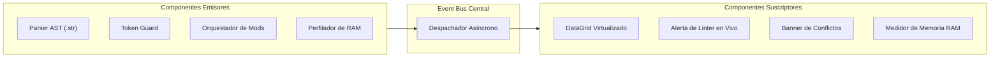

# Especificación del Bus de Eventos Asíncronos - Solaris Nexus

## 1. Modelo de Concurrencia y Reactividad
Solaris Nexus implementa una arquitectura desacoplada orientada a eventos (**Event-Driven Architecture**). La sincronización en tiempo real entre el servidor WAMP y el cliente web se realiza mediante **Server-Sent Events (SSE)** o **WebSockets locales**, proporcionando alertas instantáneas durante el análisis masivo de cadenas y el ordenamiento de mods.



---

## 2. Contrato Estándar de Eventos (`NexusEvent`)

Todos los eventos transmitidos a través del bus implementan la siguiente interfaz de TypeScript:

```typescript
export interface NexusEvent<T = Record<string, unknown>> {
  id: string;           // UUIDv4 identificador único de la instancia del evento
  type: string;         // Nombre canónico estructurado (categoría:acción-estado)
  timestamp: string;    // Marca de tiempo ISO 8601 en UTC
  emitter: string;      // Nombre del módulo emisor
  payload: T;           // Carga útil de datos con tipado estricto
  severity?: "INFO" | "WARNING" | "ERROR" | "CRITICAL";
}
```

---

## 3. Catálogo Exhaustivo de Eventos

### 3.1. Eventos de Localización y Parseo de Cadenas

#### `str:file-ingested`
Emitido al leer con éxito un archivo `.str` desde el sistema de archivos local.
```json
{
  "id": "1e9b2c34-8d4a-4f51-b8ef-5e729a1b0001",
  "type": "str:file-ingested",
  "timestamp": "2026-10-18T19:25:00Z",
  "emitter": "str-ingestion-service",
  "payload": {
    "source_path": "Localizations/en/String/English.str",
    "byte_size": 883532,
    "declared_num_strings": 7828,
    "has_bom": true
  }
}
```

#### `str:linter-violation-detected`
Emitido en tiempo real cuando el linter detecta comillas rotas o anomalías sintácticas.
```json
{
  "id": "2b7a4c12-3f19-4a88-9cf1-0e192a8b0002",
  "type": "str:linter-violation-detected",
  "timestamp": "2026-10-18T19:25:01Z",
  "emitter": "linter-service",
  "severity": "ERROR",
  "payload": {
    "line_number": 11639,
    "entry_id": "IDSGameOverDialogHasLostPhraseTechMilitary",
    "violation_code": "MISSING_OPENING_QUOTE",
    "raw_value": "Nuestro imperio, antaño próspero, yace ahora en ruinas.\"",
    "suggested_fix": "\"Nuestro imperio, antaño próspero, yace ahora en ruinas.\""
  }
}
```

#### `str:token-guard-alert`
Emitido cuando una traducción altera, suprime o desordena variables esenciales del motor C++.
```json
{
  "id": "3c8d1e23-4a56-4b77-8d99-1f283b9c0003",
  "type": "str:token-guard-alert",
  "timestamp": "2026-10-18T19:25:02Z",
  "emitter": "token-guard-service",
  "severity": "CRITICAL",
  "payload": {
    "entry_id": "IDS_RESEARCHSUBJECT_SHIPBOARD_LABS_DESCRIPTION",
    "missing_tokens": ["*VALUE0*"],
    "altered_tokens": ["%d"],
    "message": "La variable dinámica del motor *VALUE0* fue omitida en la traducción."
  }
}
```

---

### 3.2. Eventos de Gestión de Mods y Control de Memoria

#### `mod:catalog-updated`
Emitido tras completar el escaneo asíncrono de la carpeta de mods del usuario.
```json
{
  "id": "4d9e0f34-5b67-4c88-9e00-2a394c0d0004",
  "type": "mod:catalog-updated",
  "timestamp": "2026-10-18T19:25:05Z",
  "emitter": "mod-scanner-service",
  "payload": {
    "total_detected": 14,
    "total_conversions": 2,
    "total_minimods": 12,
    "scan_duration_ms": 138
  }
}
```

#### `mod:conflict-detected`
Emitido al detectar incompatibilidades declaradas en la matriz de mods seleccionados.
```json
{
  "id": "5e0f1a45-6c78-4d99-af11-3b405d1e0005",
  "type": "mod:conflict-detected",
  "timestamp": "2026-10-18T19:25:06Z",
  "emitter": "priority-orchestrator",
  "severity": "WARNING",
  "payload": {
    "source_mod": "PFX Deathmatch Mode",
    "conflicting_mod": "Beskar",
    "conflict_reason": "Ambos mods modifican las mismas tablas de escudo y tasas de regeneración planetaria."
  }
}
```

#### `mod:memory-threshold-exceeded`
Emitido cuando el peso acumulado estimado de los mods activos se acerca peligrosamente al límite de 32 bits.
```json
{
  "id": "6a1b2c3d-4e5f-6a7b-8c9d-0e1f2a3b4c5d",
  "type": "mod:memory-threshold-exceeded",
  "timestamp": "2026-10-18T19:25:08Z",
  "emitter": "ram-profiler-service",
  "severity": "CRITICAL",
  "payload": {
    "total_estimated_ram_mb": 3350,
    "max_safe_ram_mb": 3100,
    "risk_level": "EXTREME_DANGER",
    "message": "Los mods activos superan el límite de 3.2 GB de memoria de 32 bits. Se producirá un cierre inminente (MiniDump)."
  }
}
```

#### `mod:enabled-order-committed`
Emitido tras validar y guardar en disco el archivo canónico `EnabledMods.txt`.
```json
{
  "id": "7f1a2b56-7d89-4eaa-b022-4c516e2f0007",
  "type": "mod:enabled-order-committed",
  "timestamp": "2026-10-18T19:25:10Z",
  "emitter": "fs-writer-service",
  "payload": {
    "target_path": "Mods-Rebellion v1.8x/EnabledMods.txt",
    "mods_active_count": 4,
    "checksum": "e3b0c44298fc1c14"
  }
}
```

---

### 3.3. Eventos de Memoria de Traducción (TM)

#### `tm:suggestion-found`
Emitido cuando la memoria de traducción localiza una coincidencia verificada para una cadena en inglés.
```json
{
  "id": "8a3c5e79-0b2d-4f68-a1c3-e5g7i9k10008",
  "type": "tm:suggestion-found",
  "timestamp": "2026-10-18T19:25:12Z",
  "emitter": "translation-memory-service",
  "payload": {
    "str_key": "IDS_ABILITY_CUSTOM_SHIELD_DESC",
    "match_confidence": 0.98,
    "suggested_text": "Aumenta la capacidad del escudo un 20%."
  }
}
```
