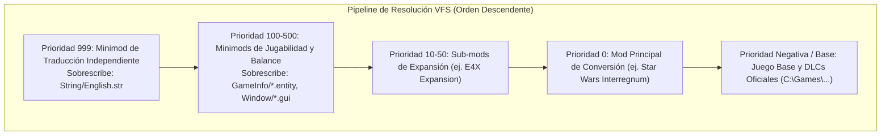
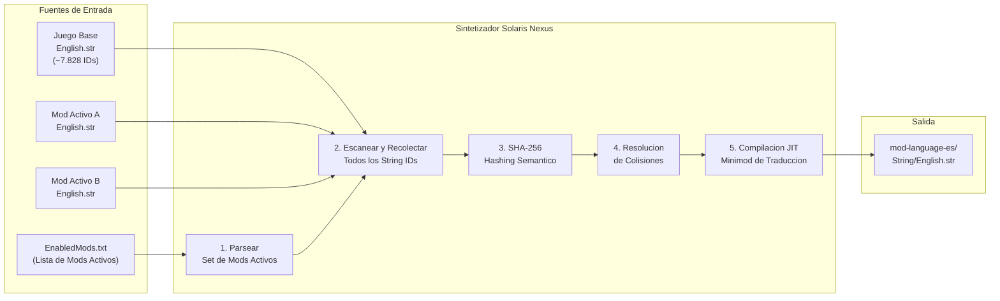

# Especificación del Sistema de Mods y VFS - Solaris Nexus (v1.0.0)

## 1. El Sistema de Archivos Virtual (VFS) de Sins of a Solar Empire

El motor de *Ironclad Games* opera mediante una arquitectura de capas denominada **Virtual File System (VFS)**. En tiempo de ejecución, el motor resuelve las solicitudes de archivos consultando las capas en estricto orden descendente de prioridad:



Cuando el juego requiere una entidad, textura, sonido o cadena de texto (como `String\English.str`), el VFS utiliza la primera ocurrencia encontrada en la lista de mods activos. Si ningún mod activo contiene el archivo, el motor recurre a la carpeta de instalación base.

---

## 2. Gramática Canónica de `EnabledMods.txt`

La lista activa de mods y su orden de ejecución se guardan en:
```text
C:\Users\<TuUsuario>\Documents\My Games\Ironclad Games\Sins of a Solar Empire Rebellion\Mods-Rebellion v1.8x\EnabledMods.txt
```

### Sintaxis Estándar del Archivo:
```text
TXT2
SinsArchiveVersion 197
Version 0
enabledModNameCount <CANTIDAD_ENTERA>
enabledModName "<NOMBRE_EXACTO_CARPETA_1>"
enabledModName "<NOMBRE_EXACTO_CARPETA_2>"
...
```

### Reglas Críticas del Motor:
1. **Inversión de Precedencia:** El primer mod listado (línea 5) tiene la **prioridad más alta** en la jerarquía del VFS.
2. **Conteo Estricto:** `enabledModNameCount` debe coincidir exactamente con el número de líneas `enabledModName` posteriores. Si hay discrepancias, el juego restaura la lista por defecto.
3. **Sensibilidad a Mayúsculas:** El nombre de la carpeta debe coincidir exactamente con el nombre en disco dentro de `Mods-Rebellion v1.8x/`.

---

## 3. Clasificación de Mods y Alcance Lingüístico

| Categoría de Mod | Ejemplos | Cadenas Totales | Alcance de Traducción |
| :--- | :--- | :---: | :--- |
| **Conversiones Totales** | *Star Wars: Interregnum*, *Star Trek: Armada III*, *Sins of the Prophets* | 9.000 - 14.000 | Sustituyen todas las facciones, naves y armas. Introducen miles de IDs nuevos. |
| **Overhauls y Expansiones** | *Enhanced 4X Mod (E4X)*, *Distant Stars* | 8.000 - 9.500 | Conservan las razas base (TEC, Advent, Vasari), añadiendo capas económicas y de gobierno. |
| **Minimods de Jugabilidad** | *Doubled Fleet Supply*, *Faster Combat*, *Infinite Research* | 5 - 50 | Modifican constantes de balance y pequeñas cadenas de interfaz. Impacto mínimo de texto. |

---

## 4. Arquitectura de Minimods de Traducción Independientes (Prioridad 999)

Modificar los archivos directamente dentro de la carpeta de un mod de terceros genera inconvenientes graves:
- Las actualizaciones del mod sobrescriben y eliminan las traducciones.
- Las sumas de verificación (*checksums*) pueden alterarse en partidas multijugador.

### La Solución de Solaris Nexus: Minimods de Traducción Aislados
Solaris Nexus compila un paquete de mod independiente y liviano:
```text
C:\Users\<TuUsuario>\Documents\My Games\Ironclad Games\...\Mods-Rebellion v1.8x\
  └── [ES] Star Wars Interregnum Traduccion/
      └── String/
          └── English.str   <-- (Solo cadenas traducidas con UTF-8 BOM)
```

En `EnabledMods.txt`, este parche se sitúa en la primera posición (**Prioridad 999**). El juego carga todos los modelos 3D, texturas y sonidos del mod original en inglés, pero extrae todos los textos en español desde el minimod de traducción.

---

## 5. Algoritmo de Resolución de Conflictos

Derivado de la lógica del script de respaldo `E4XInterregnumModManager.js`, el orquestador valida la compatibilidad antes de guardar en disco:

```typescript
export interface ModItem {
  id: string;
  name: string;
  priority: number;
  incompatibleMods: string[];
  category: "TOTAL_CONVERSION" | "OVERHAUL" | "MINIMOD" | "TRANSLATION";
}

export function compileEnabledMods(selectedMods: ModItem[]): string {
  // 1. Detección de Conflictos
  const activeIds = new Set(selectedMods.map(m => m.id));
  for (const mod of selectedMods) {
    for (const conflict of mod.incompatibleMods) {
      if (activeIds.has(conflict)) {
        throw new Error(`Incompatibilidad detectada: ${mod.name} colisiona con ${conflict}`);
      }
    }
  }

  // 2. Ordenamiento Descendente por Prioridad (Mayor prioridad arriba)
  const sorted = [...selectedMods].sort((a, b) => b.priority - a.priority);

  // 3. Serialización Canónica TXT2 SinsArchiveVersion 197
  let buffer = "TXT2\r\nSinsArchiveVersion 197\r\nVersion 0\r\n";
  buffer += `enabledModNameCount ${sorted.length}\r\n`;
  for (const mod of sorted) {
    buffer += `enabledModName "${mod.name}"\r\n`;
  }

  return buffer;
}
```

---

## 6. Sintetizador Dinámico de Idiomas por Sesión Activa

> **Badge:** `🟡 EN DESARROLLO`

### 6.1 Planteamiento del Problema

Un usuario puede tener más de 50 mods instalados, pero solo 3–6 activos simultáneamente. Cargar las tablas de cadenas de *todos* los mods instalados en un mega-archivo único es **catastróficamente peligroso** en un motor de 32 bits:

| Riesgo | Descripción |
| :--- | :--- |
| **Agotamiento de Memoria** | Un mega-archivo con más de 40.000 entradas puede consumir 15–30 MB del heap de cadenas. Con el techo LAA en ~3,2 GB, esto roba presupuesto a texturas y mallas 3D. |
| **Canibalismo de Lore** | Si *Star Wars: Interregnum* y *Sins of the Prophets* definen ambos `IDS_SHIP_CAPITAL_01`, el mega-archivo sobrescribe silenciosamente uno con el otro. El jugador ve "Star Destroyer" en un mod de Halo — o viceversa. |
| **Cadenas Fantasma** | IDs de mods inactivos pueden seguir siendo resueltos por el VFS, provocando que la interfaz muestre textos de mods que no están cargados, resultando en descripciones sin sentido. |

### 6.2 Arquitectura: Síntesis por Alcance de Sesión

En lugar de un archivo global, Solaris Nexus genera un **minimod de traducción por sesión** que contiene *únicamente* la unión de cadenas de los mods actualmente activos.



### 6.3 Detección de Colisiones Semánticas con SHA-256

Cuando dos mods definen el mismo `StringInfo.ID`, el sintetizador debe determinar si representan el **mismo concepto** o **lore diferente**:

```typescript
import { createHash } from "crypto";

export interface StringEntry {
  id: string;
  value: string;
  sourceModId: string;
}

export type CollisionVerdict = "AUTO_TRANSLATE" | "MANUAL_REVIEW";

export interface CollisionReport {
  id: string;
  entries: StringEntry[];
  verdict: CollisionVerdict;
  fingerprint: string;
}

/**
 * Calcula una huella SHA-256 normalizada del texto base en inglés.
 * Dos entradas con huellas idénticas => mismo concepto => auto-traducir.
 * Huellas diferentes => lore diferente => revisión manual requerida.
 */
export function computeSemanticFingerprint(value: string): string {
  const normalized = value
    .toLowerCase()
    .replace(/\s+/g, " ")
    .trim();
  return createHash("sha256").update(normalized, "utf8").digest("hex");
}

export function detectCollisions(
  allEntries: StringEntry[]
): CollisionReport[] {
  const grouped = new Map<string, StringEntry[]>();

  for (const entry of allEntries) {
    const existing = grouped.get(entry.id) ?? [];
    existing.push(entry);
    grouped.set(entry.id, existing);
  }

  const reports: CollisionReport[] = [];

  for (const [id, entries] of grouped) {
    if (entries.length <= 1) continue;

    const fingerprints = new Set(
      entries.map((e) => computeSemanticFingerprint(e.value))
    );

    reports.push({
      id,
      entries,
      verdict: fingerprints.size === 1 ? "AUTO_TRANSLATE" : "MANUAL_REVIEW",
      fingerprint: [...fingerprints].join(" | "),
    });
  }

  return reports;
}
```

#### Matriz de Decisión

| Escenario | Huellas | Acción |
| :--- | :---: | :--- |
| Mismo ID, mismo texto en inglés (ej. ambos dicen "Attack") | 1 única | `AUTO_TRANSLATE` — aplicar traducción española cacheada |
| Mismo ID, texto diferente en inglés (ej. "TIE Fighter" vs "Seraph Fighter") | 2+ únicas | `MANUAL_REVIEW` — señalar al usuario en la UI con visor de diferencias |
| ID único entre todos los mods | N/A | `AUTO_TRANSLATE` — sin colisión, traducir normalmente |

### 6.4 Compilación JIT del Minimod

Tras la resolución de colisiones, el sintetizador ensambla la salida final:

```text
Mods-Rebellion v1.8x/
  mod-language-es/
      String/
          English.str    <- Unión de todas las traducciones resueltas
      meta.json          <- Manifiesto de compilación de Solaris Nexus
```

**Esquema de `meta.json`:**
```json
{
  "generator": "solaris-nexus",
  "version": "1.0.0",
  "targetLanguage": "es",
  "buildTimestamp": "2026-10-18T23:45:00Z",
  "sourceMods": [
    { "id": "star-wars-interregnum", "stringsContributed": 4200 },
    { "id": "e4x-mod", "stringsContributed": 1350 }
  ],
  "totalStrings": 13378,
  "collisionsAutoResolved": 42,
  "collisionsManualPending": 3
}
```

El sintetizador registra automáticamente `mod-language-es` en la posición 1 de `EnabledMods.txt` (Prioridad 999), garantizando que sobrescriba todas las demás fuentes de cadenas.

### 6.5 Estimación de Presupuesto de Memoria

Antes de compilar, el sintetizador estima si la tabla de cadenas resultante cabe dentro del presupuesto de memoria de 32 bits:

```typescript
export interface MemoryEstimate {
  totalStrings: number;
  estimatedBytes: number;
  percentOfBudget: number;
  safe: boolean;
}

const LAA_CEILING_BYTES = 3_355_443_200; // ~3,12 GiB límite práctico
const STRING_OVERHEAD_BYTES = 64; // Overhead del motor por entrada
const SAFE_STRING_BUDGET_PERCENT = 2.0; // Las cadenas no deben superar el 2%

export function estimateStringMemory(
  entries: Array<{ value: string }>
): MemoryEstimate {
  const totalBytes = entries.reduce((sum, e) => {
    // UTF-16 en memoria del motor: 2 bytes por carácter + overhead
    return sum + e.value.length * 2 + STRING_OVERHEAD_BYTES;
  }, 0);

  const percent = (totalBytes / LAA_CEILING_BYTES) * 100;

  return {
    totalStrings: entries.length,
    estimatedBytes: totalBytes,
    percentOfBudget: Math.round(percent * 100) / 100,
    safe: percent <= SAFE_STRING_BUDGET_PERCENT,
  };
}
```

| Cantidad de Cadenas | Memoria Estimada | % de 3,12 GiB | Veredicto |
| ---: | ---: | ---: | :--- |
| 8.000 (juego base) | ~2,5 MB | 0,07% | ✅ Seguro |
| 14.000 (base + mod TC) | ~4,8 MB | 0,14% | ✅ Seguro |
| 30.000 (base + 3 mods TC) | ~11 MB | 0,33% | ⚠️ Marginal |
| 50.000+ (mega-archivo) | ~20 MB+ | 0,60%+ | ❌ Riesgoso — presupuesto de texturas robado |

### 6.6 Casos Límite No Sintetizables

Algunos escenarios no pueden resolverse automáticamente:

1. **Cadenas Incrustadas en Binarios:** Algunos mods codifican cadenas directamente en archivos `.entity` o `.mesh`. Estas no son accesibles mediante archivos `.str` y no pueden traducirse sin parcheo binario.
2. **Concatenación Dinámica de Cadenas:** Si un mod construye cadenas en tiempo de ejecución (ej. `"Ship: " + shipName`), los fragmentos de concatenación pueden no aparecer como unidades traducibles completas.
3. **Brechas de Cobertura de Fuentes:** El texto traducido puede usar caracteres (ñ, á, ü) no presentes en el archivo de fuente personalizado del mod. Solaris Nexus debe validar la cobertura de glifos en `Font/*.font` antes del despliegue.
4. **Códigos de Formato Específicos del Mod:** Algunos mods usan tokens de formato personalizados (`%MOD_VAR%`, `[color:...]`) que deben preservarse textualmente durante la traducción.

---

## 7. Comparativa de Arquitectura: Rebellion (32-bit) vs. Sins of a Solar Empire II (64-bit)

> **Badge:** `PRÓXIMAMENTE`

La llegada de **Sins of a Solar Empire II** marca un cambio generacional completo en el motor y en la infraestructura de mods:

### 7.1 Matriz Comparativa de Motores

| Dimensión Técnica | Sins of a Solar Empire: Rebellion | Sins of a Solar Empire II |
| :--- | :--- | :--- |
| **Motor de Juego** | Iron Engine legado (32-bit / DirectX 9) | **Iron Engine 3** (64-bit nativo / DirectX 12) |
| **Límite de Direccionamiento RAM** | ~3.2 GB a 3.8 GB (LAA Wall - Crash por MiniDump) | **Ilimitado** (Acceso total a la memoria física del equipo) |
| **Formato de Cadenas Fuente** | Archivo `.str` con cabecera fija `TXT/NumStrings` | Archivos CSV estructurados (`.localized_text_csv`) |
| **Formato de Cadenas en Ejecución** | Binario interno UTF-16 hardcoded a `English.str` | Archivos **JSON compilados** (`.localized_text`) |
| **Compilador de Textos Oficial** | Inexistente (edición manual de archivos de texto) | `LocalizedTextBuilder` y orquestador `Peon` (SDK oficial) |
| **Distribución y Descarga de Mods** | Manual vía [ModDB](https://www.moddb.com/games/sins-of-a-solar-empire-rebellion/mods) + archivo `EnabledMods.txt` | **Integración nativa con mod.io** dentro del menú del juego |
| **Sincronización Multijugador** | El cliente debe tener los mismos mods instalados a mano | Auto-descarga y sincronización de mods al unirse a la sala |
| **Ruta de Almacenamiento Local** | `Documents\My Games\Ironclad Games\...\Mods-Rebellion v1.8x\` | `%LOCALAPPDATA%\sins2\mods\` |

### 7.2 Flujo de Localización en Sins II vs. Solaris Nexus

En Sins II, el pipeline de traducción oficial opera mediante:
1. **Edición:** Los autores editan tablas CSV simples (`es.localized_text_csv`) con columnas `Key,Source,Target`.
2. **Construcción:** El ejecutable `LocalizedTextBuilder` o el script de empaquetado `run-peon.py` procesa el CSV y genera la estructura JSON requerida por Iron Engine 3.
3. **Distribución:** Se sube el paquete a la plataforma **mod.io** mediante su API REST pública.

**Estrategia de Evolución de Solaris Nexus:**
Solaris Nexus se diseña de manera modular para actuar como puente:
- **v1.x (Rebellion):** Domina el formato `.str`, UTF-8 BOM, CRLF y `EnabledMods.txt`.
- **v2.x (Sins II Ready):** Incorporará adaptadores para exportar diccionarios a `.localized_text_csv` y conectar directamente con la API de mod.io mediante tokens de autenticación OAuth2.

