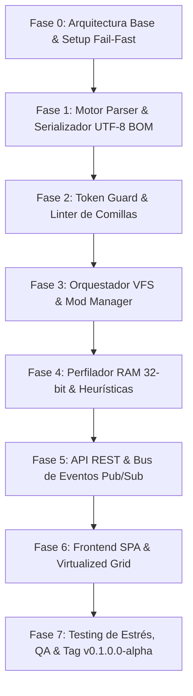

# SOLARIS NEXUS STUDIO - PLAN DE DESARROLLO MAESTRO (README-DEV)

**Organización:** Clepces org. ltd  
**Proyecto:** Gamer / Tools - *Sins of a Solar Empire: Rebellion*  
**Suite:** Solaris Nexus Studio  
**Tipo de Aplicación:** Plataforma Web Local / Suite de Ingeniería, Localización y Orquestación VFS (Desktop Local SPA + API REST Server WAMP)  
**Versión Objetivo:** `v0.1.0.0-alpha`  
**Plataforma de Despliegue:** Windows (WAMP stack: Apache 2.4+ / PHP 8.2+, Navegadores Chromium/Firefox/Edge)  
**Entorno de Datos:** SQLite / MySQL 8.0 (PDO con Prepared Statements)  
**Stack Tecnológico:**
- **Frontend:** TypeScript 5+ (Tipado estricto, cero `any`), Modern CSS (Cyber Sci-Fi Theme), Virtualized DOM DataGrid (para 8.000+ filas de texto).
- **Backend:** PHP 8.2+ asíncrono / PSR compliant, Node.js (herramientas de compilación, linters y tests unitarios).
- **Herramientas de Motor:** Integración binaria con `ConvertData_Rebellion.exe`, Serializador binario UTF-8 BOM + CRLF.

---

## 1. ESQUEMA DE VERSIONADO CORPORATIVO (FORMATO CUÁDRUPLE)

Siguiendo el estándar semántico corporativo de cuatro posiciones numéricas delimitadas por puntos y etiqueta de ciclo de vida:

$$\text{v}[\text{Alto}].[\text{Medio}].[\text{Bajo}].[\text{Parche}]-[\text{Ciclo}]$$

| Posición | Segmento | Tipo de Actualización | Criterio de Incremento |
| :---: | :---: | :---: | :--- |
| **1ª** | **Alto** (*Major*) | Ruptura Arquitectónica | Cambios mayores en la arquitectura base, refactorización completa de la base de datos o incompatibilidad retroactiva total con versiones anteriores. |
| **2ª** | **Medio** (*Minor*) | Módulo / Característica Mayor | Incorporación de módulos completos funcionales (ej. inclusión del Gestor de Mods, Estudio de Traducción, Integración VFS). La versión `v0.1.0.0-alpha` marca el primer hito funcional. |
| **3ª** | **Bajo** (*Revision*) | Optimización / Mejora Interna | Mejoras de rendimiento en el scroll virtual, refinamientos en el motor de expresiones regulares de Token Guard, o soporte adicional de tipos de archivo. |
| **4ª** | **Parche** (*Patch*) | Corrección de Errores / Hotfix | Solución de bugs específicos, ajustes de sintaxis, corrección de escapes de caracteres, linters y parches de seguridad puntuales. |
| **Tag** | **Ciclo** (*Lifecycle*) | `alpha` \| `beta` \| `rc` \| `release` | Estado de maduración del entregable corporativo. |

---

## 2. INTRODUCCIÓN GENERAL Y VISIÓN INTEGRAL DEL PROYECTO

### 2.1. Problema de Ingeniería Resuelto
El motor de *Sins of a Solar Empire: Rebellion* (desarrollado en C++ de 32 bits bajo DirectX 9 por Ironclad Games) presenta particularidades rígidas que conducen a cierres catastróficos (*Crash to Desktop* / *MiniDump*) si no se manipulan con herramientas especializadas:
1. **Llamada binaria compilada para localización:** El binario busca explícitamente `Localizations/<lang>/String/English.str`. Nombrar el archivo como `Spanish.str` causa un error `0x2 (ERROR_FILE_NOT_FOUND)` y el colapso inmediato del juego.
2. **Tríada de codificación obligatoria:** Todo archivo `.str` requiere Byte Order Mark (`0xEF 0xBB 0xBF`), retornos de línea Windows (`\r\n` / CRLF) y cabecera estricta `TXT` + `NumStrings <N>`.
3. **Peligro de corrupción de variables de motor:** Si un traductor altera tokens dinámicos como `[VALUE]`, `%s`, `%d`, `{0}` o corrompe comillas dobles, el juego congela su analizador léxico.
4. **Techo de memoria de 32 bits (Large Address Aware):** El límite físico virtual es de ~3.2 GB a 3.8 GB de memoria RAM. La combinación desordenada de mods pesados satura este espacio y detona fallos de asignación (`malloc`/`new`).

### 2.2. Propósito de Solaris Nexus Studio
Proveer un entorno empresarial desacoplado, robusto y automatizado que garantice:
- Gestión y traducción integral de las más de 7.800 entradas del juego base y de mods.
- Inyección no destructiva de traducciones mediante minimods con **Prioridad 999** en el sistema de archivos virtual (*Virtual File System*).
- Prevención activa de fugas de memoria, validación de variables protegidas (*Token Guard*) y verificación de presupuestos de RAM de 32 bits antes de aplicar cambios.
- Protocolo de seguridad **Cero Stack Traces (UUID Safety)**, impidiendo la exposición de rutas locales o datos sensibles en errores de red.

---

## 3. ÍNDICE MAESTRO DE FASES DE DESARROLLO (HACIA v0.1.0.0-ALPHA)

El desarrollo se encuentra compartimentado en **8 fases aisladas**. Cada fase cuenta con sus propios criterios de aceptación, pruebas unitarias y validaciones de rendimiento para evitar regresiones o colisiones entre áreas.



---

### FASE 0: ARQUITECTURA BASE, GOBERNANZA Y CONFIGURACIÓN FAIL-FAST
- **Área:** Infraestructura & Kernel
- **Objetivos:**
  1. Configurar la estructura formal de directorios según `project-structure.md` en estricto kebab-case.
  2. Implementar blindaje de entorno (`.env` y validador fail-fast al arranque en PHP).
  3. Crear el servicio centralizado de registro de auditoría (`logger-service.php`) con identificadores UUID v4 (`uuid-generator.php`).
  4. Configurar `.gitignore` y reglas locales de control de versiones Git.
- **Entregables:**
  - `config/app-config.php`, `config/database-config.php`, `.env.example`.
  - `src/backend/utils/uuid-generator.php`, `src/backend/utils/logger-service.php`.
  - Directorios físicos `/storage/logs`, `/storage/cache`, `/storage/backups`.
- **Criterio de Validación:** El sistema se detiene de inmediato si faltan variables críticas y registra errores con UUID sin exponer rutas físicas.

---

### FASE 1: NÚCLEO DEL PARSER `.STR` Y SERIALIZADOR BINARIO CANÓNICO
- **Área:** Backend Engine / I/O Seguro
- **Objetivos:**
  1. Implementar el analizador léxico/sintáctico (`str-parser-service.php`) capaz de procesar secuencialmente archivos `.str` de más de 7.800 cadenas sin desbordamiento de memoria (uso de buffers en streaming asíncrono).
  2. Implementar el conversor canónico de salida (`byte-buffer-helper.php`): inyección obligatoria de BOM UTF-8 (`0xEF 0xBB 0xBF`), normalización estricta a CRLF (`\r\n`), y recálculo automático de `NumStrings <N>`.
  3. Generar respaldos automáticos previos a cualquier operación de escritura en `/storage/backups`.
- **Entregables:**
  - `src/backend/services/str-parser-service.php`.
  - `src/backend/utils/byte-buffer-helper.php`.
  - Pruebas unitarias de codificación binaria y recuento de cadenas.
- **Criterio de Validación:** Archivos exportados deben abrirse limpiamente en el visor hexadecimal y ser aceptados por el motor de *Sins of a Solar Empire: Rebellion* sin alerta de sintaxis.

---

### FASE 2: TOKEN GUARD & LINTER DE CARACTERES ESPECIALES
- **Área:** Backend Logic / Linter de Seguridad
- **Objetivos:**
  1. Implementar `token-guard-service.php` para extracción y validación de variables reservadas de motor: `[VALUE]`, `%s`, `%d`, `{0}`, `\n`, etc.
  2. Implementar `linter-service.php` para verificar el balance exacto de comillas dobles, escapes erróneos y caracteres nulos (`0x00`).
  3. Bloquear de forma determinista la persistencia de traducciones si se detecta mutilación o alteración de tokens dinámicos.
- **Entregables:**
  - `src/backend/services/token-guard-service.php`.
  - `src/backend/services/linter-service.php`.
  - `src/shared/constants/reserved-tokens.ts`.
- **Criterio de Validación:** Pruebas unitarias con casos corruptos (`sample-corrupted.str`) arrojando errores específicos de validación con referencia de línea exacta.

---

### FASE 3: ORQUESTADOR VFS Y GESTOR DE MODS (`ENABLEDMODS.TXT`)
- **Área:** Backend VFS & Mod Engine
- **Objetivos:**
  1. Implementar `mod-orchestrator.php` para lectura y escritura sintáctica de `EnabledMods.txt`.
  2. Diseñar el inyector de minimods de traducción con asignación de **Prioridad 999** (capa superior no destructiva).
  3. Implementar detector de colisiones semánticas y cálculo de hashes SHA-256 para archivos sobreescritos.
  4. Generador de empaquetado nativo en `Localizations/es/String/English.str`.
- **Entregables:**
  - `src/backend/services/mod-orchestrator.php`.
  - `src/backend/services/language-packager.php`.
  - `src/backend/repositories/mod-repository.php`.
- **Criterio de Validación:** El archivo generado `EnabledMods.txt` debe ordenar los mods en cascada descendente respetando dependencias e inyectando la traducción en la cumbre.

---

### FASE 4: MONITOR DE MEMORIA RAM 32-BIT & HEURÍSTICA DE RECORTE
- **Área:** Backend & Diagnostics Guard
- **Objetivos:**
  1. Implementar `ram-profiler-service.php` para estimar el consumo de memoria virtual LAA según los mods activos (techo crítico de ~3.250 MB).
  2. Implementar cálculo heurístico de expansión de texto en español (+20% a +30%) para advertir de desbordamiento visual (*Text Clipping*) en cajas fijas de InfoCard.
- **Entregables:**
  - `src/backend/services/ram-profiler-service.php`.
  - `src/shared/constants/engine-limits.ts`.
- **Criterio de Validación:** Detección de combinaciones de mods que excedan el límite con emisión de advertencia de riesgo alto/crítico.

---

### FASE 5: CONTROLADORES API REST Y BUS DE EVENTOS PUB/SUB
- **Área:** Backend HTTP / Asincronía
- **Objetivos:**
  1. Crear endpoints REST seguros conforme a `api-spec.md` con respuestas normalizadas (`success`, `data`, `error_uuid`, `timestamp`).
  2. Blindar todas las respuestas contra stack traces (UUID Safety: registro interno en `/storage/logs`, mensaje amigable al cliente).
  3. Implementar el Bus de Eventos Pub/Sub (`events-spec.md`) para notificación de diagnósticos y progreso en tiempo real.
- **Entregables:**
  - `src/backend/controllers/string-controller.php`.
  - `src/backend/controllers/mod-controller.php`.
  - `src/backend/controllers/system-controller.php`.
- **Criterio de Validación:** Toda respuesta de error HTTP 4xx/5xx devuelve exclusivamente un código UUID v4 sin rutas de directorios locales.

---

### FASE 6: FRONTEND SPA Y COMPONENTES WEB VIRTUALIZADOS
- **Área:** Frontend TypeScript / UI
- **Objetivos:**
  1. Construir la estructura cliente SPA en TypeScript con arquitectura limpia y cero `any`.
  2. Diseñar la tabla virtualizada (`str-virtual-grid.ts`) capaz de renderizar fluidamente a 60 FPS más de 8.000 cadenas de texto utilizando un búfer de ventana DOM de 40-50 elementos visibles (evitando fugas y consumo excesivo de memoria).
  3. Modal de edición con Token Guard visual en tiempo real y resaltador de sintaxis.
  4. Selector de mods, matriz de prioridades y visualizador del medidor de carga RAM de 32 bits.
  5. Componentes con Badges de Estado (`[ACTIVO]`, `[EN DESARROLLO]`, `[PRÓXIMAMENTE]`).
- **Entregables:**
  - `public/index.html`, `public/assets/css/main-theme.css`, `public/assets/css/datatable-virtual.css`.
  - `src/frontend/components/str-virtual-grid.ts`, `string-editor-modal.ts`, `mod-selector-panel.ts`, `memory-load-meter.ts`.
  - `src/frontend/state/translation-store.ts`, `mod-store.ts`, `event-bus.ts`.
  - `src/frontend/api-client/nexus-api-client.ts`.
- **Criterio de Validación:** Scroll ininterrumpido sin degradación de framerate ni fugas de memoria tras 1.000 operaciones de scroll.

---

### FASE 7: BATERÍA DE PRUEBAS AUTOMATIZADAS, VALIDACIÓN QA Y DESPLIEGUE v0.1.0.0-ALPHA
- **Área:** QA, Testing & Release
- **Objetivos:**
  1. Ejecución de suite de pruebas unitarias (PHPUnit / Vitest o Jest para TypeScript).
  2. Verificación de integridad de 7.828 cadenas canónicas de *Sins of a Solar Empire: Rebellion*.
  3. Validación de despliegue en entorno WAMP local (`c:\wamp64\www\...`).
  4. Creación del commit de hito y etiquetado Git local: `v0.1.0.0-alpha`.
- **Entregables:**
  - `tests/unit/str-parser.test.ts`.
  - `tests/unit/token-guard.test.ts`.
  - `tests/unit/mod-priority.test.ts`.
  - `tests/unit/encoding-bom.test.ts`.
  - Registro de auditoría y reporte de verificación.
- **Criterio de Validación:** 100% de pruebas unitarias exitosas, cero linter errors, cero fugas de memoria detectadas.

---

## 4. MATRIZ DE AISLAMIENTO POR ÁREA TÉCNICA

Para asegurar que cada subsistema pueda ser desarrollado, depurado y auditado sin riesgo de interferencia cruzada, se definen los siguientes contratos de aislamiento:

```
+-----------------------------------------------------------------------------------+
|                              SOLARIS NEXUS STUDIO                                 |
+-----------------------------------------------------------------------------------+
|  [ÁREA 1: FRONTEND SPA]          [ÁREA 2: API & BUS]        [ÁREA 3: KERNEL BACKEND]  |
|  - Virtual DataGrid              - Endpoints REST           - AST Parser & Linter |
|  - Token Highlighter             - Pub/Sub Event Bus        - UTF-8 BOM/CRLF Buffer |
|  - Reactive State Stores         - UUID Safety Middleware   - VFS Mod Orchestrator|
|  - RAM Load Meter UI             - Error Interceptor        - RAM Profiler Service|
+-----------------------------------------------------------------------------------+
|  [ÁREA 4: PERSISTENCIA & STORAGE]                 [ÁREA 5: MOTOR SINS C++ / OS]   |
|  - SQLite / MySQL Schema                          - Localizations/es/             |
|  - Translation Memory (TM)                        - EnabledMods.txt               |
|  - Backups & Cache Seguro                         - ConvertData_Rebellion.exe     |
+-----------------------------------------------------------------------------------+
```

1. **Aislamiento Frontend / Backend:** El cliente interactúa exclusivamente mediante contratos fuertemente tipados definidos en `src/shared/types/api-response-types.ts`. Ningún componente de interfaz accederá a I/O directo.
2. **Aislamiento de Errores (UUID Protocol):** Los errores de base de datos o de sistema de archivos son interceptados por el backend, volcados a `/storage/logs/<date>.log` con un hash UUID v4, y reportados al cliente únicamente como `{ "status": "error", "error_uuid": "..." }`.
3. **Aislamiento de Modificaciones de Juego:** Toda modificación sobre archivos originales crea previamente una instantánea en `/storage/backups/`. Las traducciones se montan preferentemente vía VFS (minimods Prioridad 999) o en `Localizations/es/String/English.str`.

---

## 5. PLANTEAMIENTO INICIAL DE EJECUCIÓN (PASO A PASO INMEDIATO)

Para dar comienzo formal e impecable al desarrollo, el orden de ejecución es el siguiente:

1. **Paso 1 (Presente):** Establecer el repositorio Git local como punto de salvado, registrar este plan de desarrollo maestro (`readme-dev.md`) y congelar la línea base.
2. **Paso 2:** Crear la estructura de carpetas física (`config/`, `public/`, `src/`, `storage/`, `tests/`) y dotar a cada carpeta de su correspondiente archivo de inicialización/seguridad (`.gitkeep` o `index.html` protector).
3. **Paso 3:** Implementar el módulo de entorno y gobernanza (`config/app-config.php`, `src/backend/utils/uuid-generator.php`, `src/backend/utils/logger-service.php`).
4. **Paso 4:** Implementar los tipos compartidos universales en TypeScript (`src/shared/types/`).
5. **Paso 5:** Desarrollar el núcleo de parseo y serialización binaria segura (`str-parser-service.php` y `byte-buffer-helper.php`) con pruebas unitarias.
