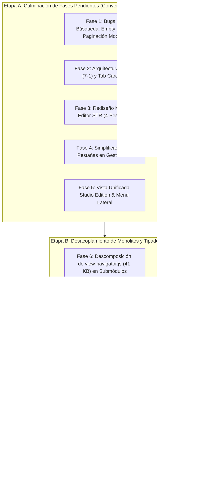

# Hoja de Ruta de Migración y Modernización - Solaris Nexus Studio

## 1. Principio Fundamental: Preservación de Estabilidad Activa
**Regla de Oro:** Queda estrictamente prohibido realizar una reescritura masiva destructiva ("Big Bang Rewrite") que destruya el trabajo funcional actual. La aplicación cuenta con una suite de pruebas de 11 fases en estado **VERDE** (`11 Aprobados, 0 Fallidos`). Todo cambio debe ejecutarse de forma incremental, manteniendo operativas las vistas legacy mientras se incorporan los módulos modernos.

---

## 2. Mapa de Fases de Ejecución

---

## 3. Desglose Detallado por Fases

### Etapa A: Culminación de Fases Pendientes

#### Fase 1: Bugs de Búsqueda, Empty State y Paginación Modular
* **Acción 1.1 (Search State):** Sincronizar el evento `input` en `translation-studio.js` y `view-navigator.js`. Al vaciar el input (`value === ''`), disparar el reseteo de `filterState` para restaurar instantáneamente el dataset completo sin estados huérfanos.
* **Acción 1.2 (Empty State):** Integrar la clase y marcado `.nexus-empty-state` con mensaje contextual en tablas que devuelvan 0 coincidencias.
* **Acción 1.3 (Paginador Universal):** Implementar `NexusPagination` en `nexus-ui.js` / `nexus-components.js`, conectándolo a las tablas del Dashboard y del Editor `.str`.

#### Fase 2: Arquitectura SASS (7-1) y Tab Carousel
* **Acción 2.1 (SASS 7-1):** Estructurar `public/assets/scss/` según el patrón 7-1, asegurando que la compilación a `public/assets/css/main-theme.css` no altere las clases CSS activas.
* **Acción 2.2 (Tab Carousel):** Crear el contenedor horizontal para pestañas con soporte de navegación lateral por flechas, rueda de ratón (`wheel`) y gestos táctiles.

#### Fase 3: Rediseño Modular del Editor de Traducción (.STR)
* **Acción 3.1 (4 Pestañas Funcionales):**
  1. *Workspace:* Panel informativo de diccionarios y métricas iniciales en cero.
  2. *Editor en Vivo:* Grilla optimizada con paginación integrada y columnas claras (ID, Original, Traducción, Tokens, Acción).
  3. *Telemetría & Diagnóstico:* Indicadores de variables protegidas (`Token Guard`), validación BOM y estado del archivo.
  4. *Reserva / Expansión:* Espacio reservado para memoria de traducción y diccionarios P2P.

#### Fase 4: Simplificación de Pestañas en Gestor VFS y Mods
* **Acción 4.1:** Renombrar subpestañas con títulos ejecutivos ágiles (`Jerarquía`, `Rutas & Detección`, `Colisiones VFS`, `Inyector Minimod`, `Monitor RAM LAA`).
* **Acción 4.2:** Desacoplar el Inyector Minimod del Monitor de Memoria RAM en tabs individuales para claridad operativa.

#### Fase 5: Menú Lateral y Vista Unificada `Studio Edition`
* **Acción 5.1:** Actualizar `sidebar.partial.html` para incorporar `Studio Edition` como la vista insignia maestra, agrupando bajo una sección claramente delimitada las vistas legacy (`Traducción .str`, `Shared Entities`, `Galaxy Forge`, etc.).
* **Acción 5.2:** Crear `public/views/studio.view.html` con layout modular que permite alternar entre espacios de trabajo (Traducción, Entidades y Galaxias) sin interferir con las rutas heredadas.

---

### Etapa B: Desacoplamiento de Monolitos y Tipado

#### Fase 6: Descomposición de `view-navigator.js`
* El archivo `view-navigator.js` ha alcanzado 41 KB de lógica mixta.
* Se dividirá en controladores específicos:
  * `navigation-router.js` (enrutamiento de hash y URLs).
  * `dashboard-tab-handler.js` (gráficos y métricas del dashboard).
  * `studio-tab-handler.js` (controlador de la vista Studio Edition).

#### Fase 7: Activación de TypeScript en `src/frontend/`
* Hidratar las carpetas vacías `api-client/`, `components/` y `state/` con los contratos y clientes tipados que compilan hacia `public/assets/js/modules/`.
* Cero uso del tipo `any` (cumplimiento estricto de la Constitución Global AIPA).

#### Fase 8: Saneamiento de Vistas con Componentes Huecos
* Rediseñar las vistas en `public/views/` sustituyendo bloques HTML repetitivos por esqueletos semánticos ligeros, reduciendo el peso de los archivos HTML en más de un 50%.

---

### Etapa C: Certificación y Release

#### Fase 9: Validación Integral de la Suite de Pruebas
* Ejecución obligatoria de `tests/run-all-tests.php`.
* Todas las 11 fases deben reportar estado **[PASÓ] Exitoso** antes de certificar la versión.

#### Fase 10: Commit SemVer Corporativo
* Generar commit local de respaldo unificado bajo la etiqueta semántica:
  `release(core): v0.4.0.0-alpha - modular architecture, sass 7-1, and str editor overhaul`
