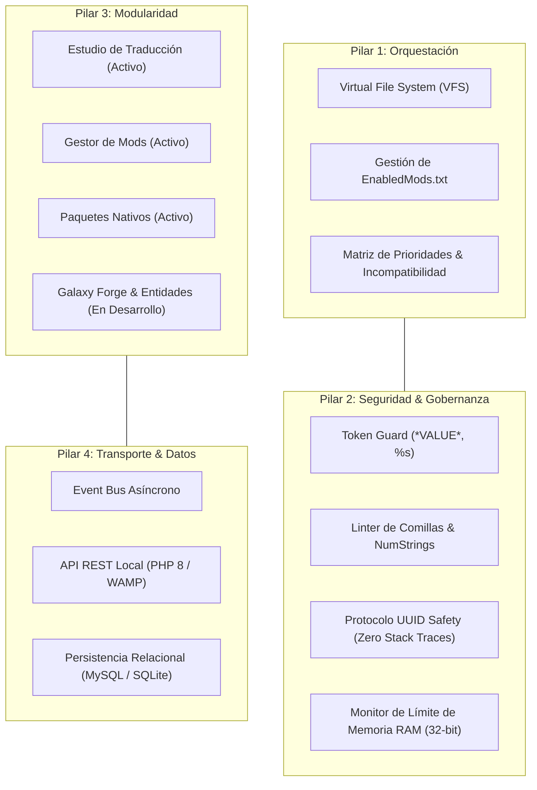

# SOLARIS NEXUS: Universal Engine Suite for Sins of a Solar Empire (v1.0.0)

**Solaris Nexus** es una plataforma de ingeniería y suite web local desarrollada para **Sins of a Solar Empire: Rebellion**, diseñada para unificar la localización idiomática universal, la orquestación avanzada del sistema de mods (*Virtual File System*) y la salvaguarda de estabilidad del motor legado de 32 bits.

---

## 1. Respuesta Técnica: ¿Por Qué Falla el Motor si el Archivo se Nombra `Spanish.str`?

Muchos usuarios asumen intuitivamente que el archivo de traducción debe nombrarse según el idioma (`Spanish.str`). Sin embargo, **hacer esto provoca un fallo inmediato del juego (*Crash to Desktop* o textos invisibles)** debido a una restricción interna del código C++ de *Ironclad Games*:

1. **La carpeta es dinámica, el nombre del archivo es una constante fija (*Hardcoded*):**
   El motor consulta la API de Steam o el emulador [steam_emu.ini](file:///C:/Games/Sins%20of%20a%20Solar%20Empire%20Rebellion/steam_emu.ini) para obtener el código del idioma (`es`, `fr`, `de`, etc.), construyendo la ruta raíz `Localizations/<código>/`.
2. **Llamada de lectura compilada en el ejecutable:**
   Al abrir el diccionario de textos, los desarrolladores no parametrizaron el nombre del archivo; dejaron grabada en el binario (`Sins of a Solar Empire Rebellion.exe`) la constante literal de texto ancho (UTF-16) `L"String\\English.str"`:
   ```cpp
   // El ejecutable ejecuta literalmente esta llamada en C++:
   CreateFileW(L"Localizations/es/String/English.str", GENERIC_READ, ...);
   ```
   Si el archivo se denomina `Spanish.str`, el sistema operativo devuelve el error `ERROR_FILE_NOT_FOUND` (`0x2`). El juego asume que no existe diccionario de idioma y colapsa al inicio.
3. **Evidencia en todos los idiomas oficiales:**
   En las versiones oficiales de francés (`fr`), alemán (`de`), italiano (`it`) y ruso (`ru`), el archivo **siempre se llama `English.str`**. Para el motor, `English.str` significa únicamente *"archivo maestro de cadenas"*.
4. **Regla de Oro de Solaris Nexus:**
   Toda traducción al español para el juego base debe desplegarse como:
   ```text
   C:\Games\Sins of a Solar Empire Rebellion\Localizations\es\String\English.str
   ```
   *(La suite mantiene simultáneamente una copia como `Spanish.str` como respaldo informativo, pero asegura que `English.str` sea el archivo activo servido al motor).*

---

## 2. Los Cuatro Pilares Fundamentales de la Suite



### 1. Pilar de Orquestación (Virtual File System & Mod Hierarchy)
Gobierna la resolución de archivos en cascada. Permite compilar y cargar minimods de traducción con **prioridad 999** por encima de conversiones totales pesadas (*Star Wars: Interregnum*, *Star Trek: Armada III*, *Sins of the Prophets*) para traducir el juego sin alterar los archivos originales de los mods.

### 2. Pilar de Seguridad y Límites de Motor (32-bit Memory Safety)
- **El Techo de Memoria RAM de 32 Bits (Large Address Aware):**
  El motor tiene un **límite físico de direccionamiento virtual de ~3.2 GB a 3.8 GB de RAM**, independientemente de cuánta memoria física tenga el equipo.
  - Si la acumulación de mods activos en `EnabledMods.txt` excede los 3.2 GB en combate masivo, el juego sufre un cierre abrupto (*MiniDump*).
  - **Solaris Nexus** incorpora un medidor de carga estimada que alerta antes de guardar configuraciones de alto riesgo.

### 3. Pilar de Modularidad y Modelo Evolutivo (Feature Badges)
La suite prioriza el núcleo operativo de traducción y gestión de mods, incorporando maquetas visuales para módulos futuros mediante **Badges de Estado**:
- `[ACTIVO]`: Traductor de cadenas `.str`, Generador de `EnabledMods.txt` y Empaquetador nativo en `Localizations/es/`.
- `[EN DESARROLLO]`: Monitor de saturación de memoria RAM 32-bit, Editor de parámetros de entidades (balance de recursos, flotas y atributos planetarios) y **Sintetizador Dinámico de Idiomas por Sesión Activa** (detección de colisiones semánticas SHA-256 + compilación JIT de minimods de traducción).
- `[PRÓXIMAMENTE]`: Editor de galaxias interactivo (Galaxy Forge Companion).

### 4. Pilar de Transporte y Capa de Persistencia
Interconexión asíncrona mediante un **Bus de Eventos Pub/Sub**, API REST con trazabilidad de errores por UUID (ocultando rutas de disco según la Constitución Corporativa) y base de datos relacional para Memoria de Traducción (TM) y catálogos de mods.

---

## 3. Índice Maestro de Documentación Bilingüe

La documentación técnica completa se encuentra organizada en dos centros de documentación independientes dentro de `docs/`:

### 🇪🇸 Documentación en Español ([docs/es/](file:///C:/wamp64/www/sins-of-sola-empire/docs/es/))
1. [architecture-spec.md](file:///C:/wamp64/www/sins-of-sola-empire/docs/es/architecture-spec.md): Arquitectura global del sistema y pipeline técnico.
2. [api-spec.md](file:///C:/wamp64/www/sins-of-sola-empire/docs/es/api-spec.md): Especificación de endpoints REST y protocolo de seguridad UUID.
3. [events-spec.md](file:///C:/wamp64/www/sins-of-sola-empire/docs/es/events-spec.md): Catálogo del Bus de Eventos asíncronos y notificaciones en tiempo real.
4. [database-schema.md](file:///C:/wamp64/www/sins-of-sola-empire/docs/es/database-schema.md): Diagrama ERD y scripts DDL SQL para bases de datos relacionales.
5. [project-structure.md](file:///C:/wamp64/www/sins-of-sola-empire/docs/es/project-structure.md): Topología de directorios y organización del código fuente.
6. [ui-components.md](file:///C:/wamp64/www/sins-of-sola-empire/docs/es/ui-components.md): Modelado UI/UX, tabla virtualizada de 8.000+ filas y Badges de estado.
7. [mod-system-spec.md](file:///C:/wamp64/www/sins-of-sola-empire/docs/es/mod-system-spec.md): Arquitectura VFS, gramática de `EnabledMods.txt`, minimods de traducción y **Sintetizador Dinámico de Idiomas por Sesión Activa** con detección de colisiones SHA-256.
8. [engineering-guidelines.md](file:///C:/wamp64/www/sins-of-sola-empire/docs/es/engineering-guidelines.md): Límites de 32 bits, integración con `ConvertData` y heurísticas de desbordamiento.
9. [user-guide.md](file:///C:/wamp64/www/sins-of-sola-empire/docs/es/user-guide.md): Manual operativo paso a paso para activación y gestión de mods.

---

### 🇬🇧 English Documentation ([docs/en/](file:///C:/wamp64/www/sins-of-sola-empire/docs/en/))
1. [architecture-spec.md](file:///C:/wamp64/www/sins-of-sola-empire/docs/en/architecture-spec.md): System architecture overview and core pipeline.
2. [api-spec.md](file:///C:/wamp64/www/sins-of-sola-empire/docs/en/api-spec.md): REST API endpoints, JSON payload schemas, and UUID Safety.
3. [events-spec.md](file:///C:/wamp64/www/sins-of-sola-empire/docs/en/events-spec.md): Asynchronous Event Bus contracts and pub/sub catalog.
4. [database-schema.md](file:///C:/wamp64/www/sins-of-sola-empire/docs/en/database-schema.md): Relational ERD and DDL SQL schema for projects and mods.
5. [project-structure.md](file:///C:/wamp64/www/sins-of-sola-empire/docs/en/project-structure.md): Source code folder hierarchy and clean architecture layout.
6. [ui-components.md](file:///C:/wamp64/www/sins-of-sola-empire/docs/en/ui-components.md): UI/UX component modeling, virtualized DataGrid, and wireframes.
7. [mod-system-spec.md](file:///C:/wamp64/www/sins-of-sola-empire/docs/en/mod-system-spec.md): Sins VFS architecture, `EnabledMods.txt` syntax, priority calculation, and **Active-Set Language Synthesizer** with SHA-256 semantic collision detection.
8. [engineering-guidelines.md](file:///C:/wamp64/www/sins-of-sola-empire/docs/en/engineering-guidelines.md): 32-bit RAM ceiling, ConvertData CLI, text clipping heuristics, and gotchas.
9. [user-guide.md](file:///C:/wamp64/www/sins-of-sola-empire/docs/en/user-guide.md): Operational manual for activating Spanish and configuring mods.
